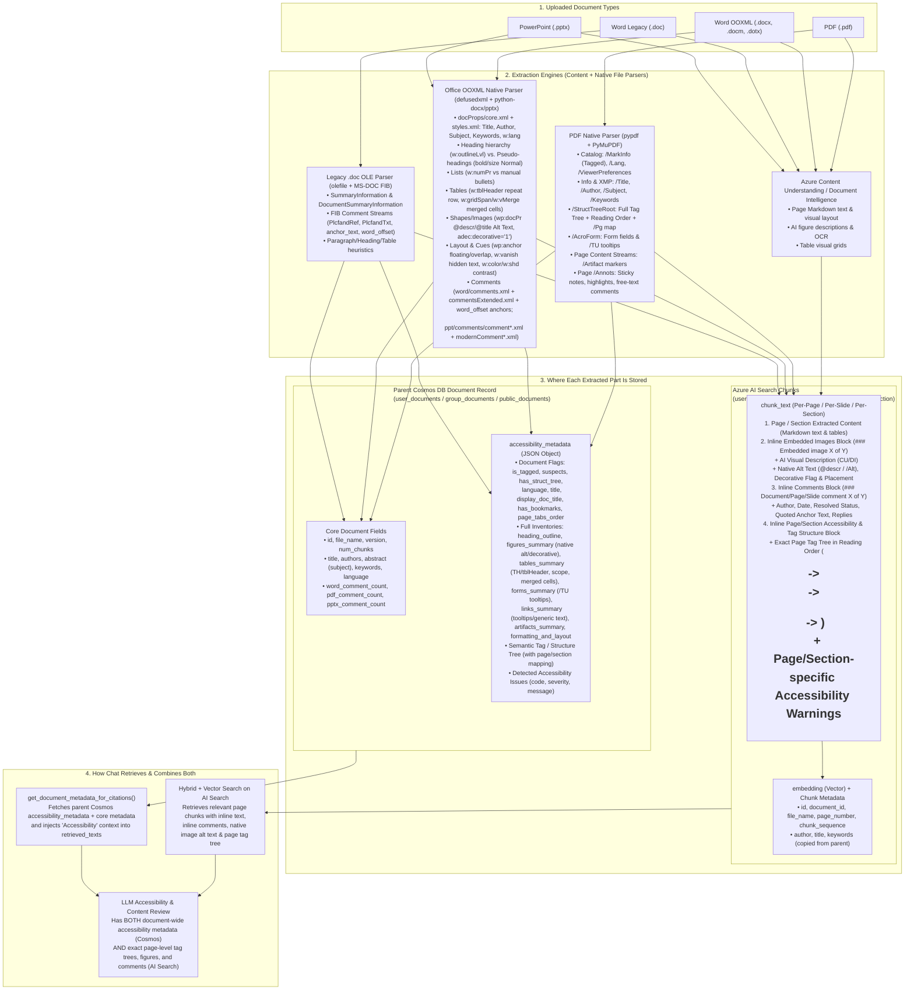
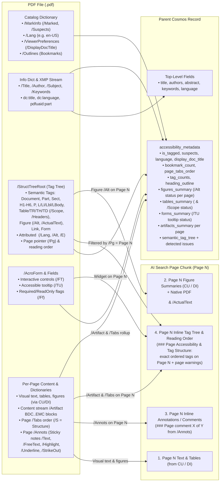
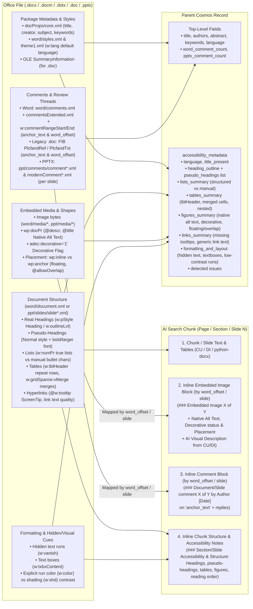
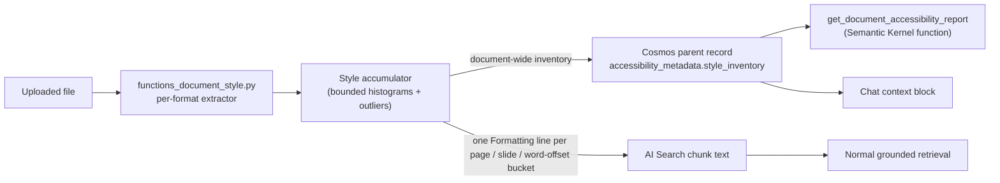

# Document Accessibility, Structure, and Comment Extraction (`PDF`, `Word`, `PowerPoint`)

**Implemented in version: 0.261.391** (formatting, style inventory, and programmatic access added in **0.261.392**)  
**Related config.py version: `0.261.392`**

## 1. Overview and Purpose

Supporting document accessibility review (WCAG 2.1 AA, Section 508, and PDF/UA) requires more than text and visual layout extraction. While **Azure AI Document Intelligence** and **Azure AI Content Understanding** excel at reading visual page surfaces and generating AI descriptions of figures, relying on visual extraction alone can mask accessibility defects:

- An **untagged PDF** (missing `/StructTreeRoot` and `/MarkInfo/Marked`) is still OCR'd into clean Markdown headings and tables by Document Intelligence or Content Understanding, making an inaccessible PDF appear structured.
- A **figure missing native alt text** (`/Alt` in PDF or `wp:docPr/@descr` in Office) still receives an AI-generated visual summary from Content Understanding, hiding the fact that the document itself lacks native alternative text.
- Neither cloud extraction service returns PDF tag hierarchies (`/StructTreeRoot`), `/Artifact` markers, `/Lang`, `/ViewerPreferences/DisplayDocTitle`, `/AcroForm` field `/TU` tooltips, PDF review annotations (`/Annots`), or native Office accessibility properties (`adec:decorative`, `w:tblHeader`, pseudo-headings, floating object overlap, hidden text, and explicit color contrast).

SimpleChat combines visual content extraction (Document Intelligence / Content Understanding) with an in-process native file-format parser (`application/single_app/functions_accessibility.py`) using already-installed Python libraries (`pypdf`, `PyMuPDF`/`fitz`, `defusedxml`, `olefile`) and stores the results across **Azure AI Search chunks** and the **parent Cosmos DB document record**.

---

## 2. Architecture and Storage Routing (Mermaid Diagrams)

### End-to-End File Dissection & Storage Routing

---

### PDF (`.pdf`) Dissection & Storage Routing

---

### Office (`.docx`, `.docm`, `.dotx`, `.doc`, `.pptx`) Dissection & Storage Routing

---

## 3. Technical Specifications

### Zero-Loss PDF `/StructTreeRoot` Handling
In PDFs exported from desktop publishing tools, 80–90% of raw `/StructTreeRoot` nodes are unattributed font-kerning `` or `<MCR>` leaves inside a paragraph (`
`). `_walk_pdf_struct_tree()` in `application/single_app/functions_accessibility.py`:
1. **Preserves 100% of structural/semantic tags** (`Document`, `Part`, `Art`, `Sect`, `Div`, `H`, `H1`–`H6`, `Title`, `P`, `L`, `LI`, `Lbl`, `LBody`, `Table`, `TR`, `TH`, `TD`, `Figure`, `Formula`, `Caption`, `Link`, `Form`, `Annot`, `Note`, `Reference`, `BlockQuote`, `TOC`, `TOCI`) and maps custom tags via `/RoleMap`.
2. **Preserves 100% of attributed `` nodes** carrying `/Lang`, `/Alt`, `/ActualText`, `/E`, or `/T`.
3. **Coalesces only unattributed kerning `` leaves** into their parent semantic element while recording `raw_tag_node_count` and `coalesced_span_count`.
4. **Maps every tag node by `/Pg` to its 1-based page number** and writes each page's ordered tag hierarchy inline into that page's AI Search chunk (`### Page Accessibility & Tag Structure (Page N)`), while storing the document-wide inventory and `accessibility_metadata` on the parent Cosmos DB record.

### Key Modules Modified
- `application/single_app/functions_accessibility.py`:
  - `extract_pdf_accessibility_metadata(pdf_path)` and `extract_pdf_page_annotations(pdf_path)`
  - `extract_office_accessibility_metadata(file_path, file_ext)` and `extract_pptx_comments(file_path)`
  - `build_word_chunk_accessibility_items(cosmos_meta, structural_events)`
  - `format_accessibility_metadata_for_chat(accessibility_metadata)`
- `application/single_app/functions_office_media.py`:
  - `_build_office_media_accessibility_map(archive)` enriches extracted embedded images with `alt_text`, `title_text`, `is_decorative`, `placement`, `allow_overlap`, and `behind_doc`.
- `application/single_app/functions_documents.py`:
  - Integrates PDF, Word (`.docx`, `.docm`, `.dotx`, `.doc`), and PowerPoint (`.pptx`) accessibility metadata and inline chunk enrichment into `process_di_document`, `process_doc`, and `process_office_template`.
  - Extends `get_document_metadata_for_citations()` to return `accessibility_metadata`, `accessibility_summary`, and `vision_analysis`.
- `application/single_app/route_backend_chats.py`:
  - Surfaces `accessibility_summary` as a synthetic `"Accessibility"` metadata citation and injects it into `retrieved_texts` during chat RAG.

### Formatting and Style Inventory (0.261.392)

Accessibility structure alone cannot answer questions such as "is the body text at least 11 pt?" or "does this deck use more than two fonts?". Version 0.261.392 also records fonts, sizes, colours, emphasis, and layout while the file is processed.

| File type | What is read | Fidelity |
|---|---|---|
| PDF | Per-span font name, size, colour, bold/italic flags, and whether each font is embedded (PyMuPDF). | Full for text spans. Base-14 fonts that are not embedded raise `PDF_FONTS_NOT_EMBEDDED` (low severity). |
| Word (`.docx`, `.docm`, `.dotx`) | Run properties resolved through the document defaults, style chain, and theme fonts and colours; paragraph alignment and line spacing; section page setup. | Theme colour tint/shade and table styles are not applied. Words with no size anywhere in the chain default to 10 pt. |
| PowerPoint (`.pptx`) | Run properties resolved through shape, layout placeholder, master text styles, and theme. | The colour map (`clrMap`) is not applied. Text with no size anywhere in the chain is assumed to be 18 pt. |
| Legacy Word (`.doc`) | Direct character properties from the CHPX/FKP binary tables and the font table. | **Best effort.** There is no style-sheet inheritance, so unset values stay unresolved and the inventory is marked `coverage: "partial"`. It was validated against a synthetic file, not a corpus of Word-authored documents. |

Anything that could not be resolved is stated in the inventory's `coverage_notes` rather than guessed.

**What is stored where**

- **Cosmos parent record** (`accessibility_metadata.style_inventory`): the document-wide inventory. It is bounded rather than raw: up to 25 fonts, 40 sizes, 25 colours, 100 outlier runs (text that differs from the body font or size, such as undersized text), with the true counts (`font_count`, `outlier_run_count`, `outliers_truncated`) kept so a consumer can tell when the list was capped. Also holds `body_font`, `body_size_pt`, `min_size_pt`, `max_size_pt`, emphasis totals, `layout`, and `page_setup`.
- **AI Search chunk text**: a compact `Formatting (characters): ...` line per page (PDF), slide (PPTX), or word-offset bucket (Word), so retrieval can answer location-specific formatting questions.
- **Not kept**: the full uncapped list of every run. Style is computed at ingestion, so documents uploaded before 0.261.392 have no style data until they are re-uploaded.

### Programmatic Access: `get_document_accessibility_report`

The **Document Search** action exposes a `get_document_accessibility_report` Semantic Kernel function that returns the stored metadata for one document. It is the supported way for a custom agent or workflow to read the complete accessibility, style, and issue data.

| Argument | Meaning |
|---|---|
| `document_id` | The document to read (required). |
| `doc_scope` | `all`, `personal`, `group`, or `public`. |
| `sections` | Comma-separated subset of `accessibility`, `style`, `issues`. Defaults to all three. |
| `page_number` | Optional 1-based page or slide. Also returns that page's stored chunk text, which carries the inline structure, formatting, and comment lines. |

Access follows the existing Document Search rules: the current user's workspace, group, and public access and the action's allowed scopes. Chat-scope uploads are refused, and documents without stored metadata return guidance to re-upload. There is deliberately no REST endpoint for this.

### Building Custom Checks

SimpleChat extracts and exposes the facts. It does **not** decide conformance: the built-in `issues` list is a set of heuristics, not a formal WCAG, Section 508, or PDF/UA conformance check, and passing it does not certify a document.

An organisation can still build its own style-guide or accessibility review:

1. Create an agent that has the Document Search action.
2. In its instructions, state the rules in measurable terms, for example "body text must be at least 11 pt", "no more than two font families", "every figure needs alternative text", "the document language must be set".
3. Tell the agent to call `get_document_accessibility_report` for the document and compare the returned `style_inventory`, `accessibility_metadata`, and `issues` against those rules, citing the values it used.
4. For location-specific findings, have it call the function again with `page_number` and read the returned chunk text.

Rules that need data SimpleChat does not extract (for example full tint/shade colour contrast, or table-style-derived formatting) will come back with unresolved values; the agent should report those as "could not be determined" rather than pass or fail.

---

## 4. Testing and Validation

- **Functional Test**: `functional_tests/test_document_accessibility_extraction.py`
  - Validates tagged vs. untagged PDF `/StructTreeRoot` traversal, attributed vs. unattributed `` handling, `<Figure /Alt>`, `<Table>/<TH /Scope>`, `/AcroForm` `/TU` tooltips, `/Artifact` detection, and PDF page `/Annots` comment extraction.
  - Validates Word (`.docx` / `.docm`) heading outline vs. pseudo-headings, structured vs. manual lists, table `w:tblHeader` and merged cells, embedded object `wp:docPr/@descr` and `adec:decorative`, floating `wp:anchor` overlap, hidden text (`w:vanish`), WCAG hex contrast ratio checks, and inline chunk placement.
  - Validates PowerPoint (`.pptx`) slide title checks, shape Z-order vs. visual reading order, slide comments, and chat metadata citation formatting.
- **Functional Test**: `functional_tests/test_document_style_extraction.py`
  - Validates PDF, DOCX (style chain, theme, page setup), PPTX, and legacy `.doc` best-effort style extraction, accumulator caps, and the chat formatting block.
- **Functional Test**: `functional_tests/test_document_accessibility_report_action.py`
  - Validates `get_document_accessibility_report` section filtering, page chunks, chat-scope and missing-metadata errors, and the plugin and citation wiring.
