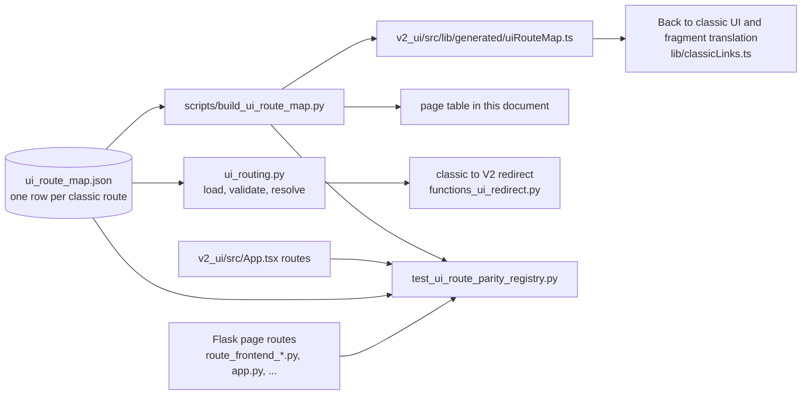

# V2 Classic Page Parity

**Implemented in version: 0.261.448**, updated in **0.261.449**, recorded in `application/single_app/config.py`.

## Overview

SimpleChat serves two interfaces from one backend: the classic server-rendered pages and the
React V2 interface under `/v2`. An administrator chooses which interfaces people
can use and their default in Appearance. That choice only works if the product knows, for every classic page, where its V2
counterpart is and what V2 still lacks.

The page parity registry is that knowledge as data. `application/single_app/ui_route_map.json`
has one row per classic page route: the V2 route that replaces it, how its query string and
fragment translate, and a status saying how complete the V2 page is. A pure-Python module,
`ui_routing.py`, answers two questions from it:

- **Where does this classic URL lead in V2?** This drives the classic to V2 redirect
  (`functions_ui_redirect.py`), so notification links, emails and bookmarks keep working when the
  V2 interface is the default.
- **Where is the classic version of this V2 URL?** This drives "Switch to legacy UI" in V2, which
  opens the classic version of the page on screen (`lib/classicLinks.ts`).

A generator copies the registry into the V2 bundle, and a guard test fails when a classic page
is added, renamed or removed without a row, or when a row names a V2 page that does not exist.

The registry supplies the map, resolvers and guard. The switch prerequisites
(`V2_INTERFACE_SELECTION_PREREQUISITES.md`) wire them into navigation. As of
0.261.449, [Interface selection](UI_INTERFACE_SELECTION.md) applies administrator
policy and persistent account preferences. There are no registered missing core
signed-in pages. Pre-sign-in Terms of Use now has a modern standalone presentation.
Route parity does not guarantee every control has identical behavior: deliberate
differences remain documented in each row, including legacy AI-connection fields
and deployment-provided custom-page embed requirements.

## Dependencies

- `application/single_app/functions_ui_mode.py`: resolves administrator policy,
  account preference and the deployment default.
- `application/single_app/route_frontend_v2.py`: serves the V2 shell at `/v2` and `/v2/<path>`.
- `scripts/build_docs_inventory.py`: its `extract_app_pages` finds the page templates the guard
  checks.
- No new packages and no browser assets.

## Technical specifications

### Architecture



The redirect and the links run only in the modern interface, which nothing selects yet.

### Files

| File | Role |
| --- | --- |
| `application/single_app/ui_route_map.json` | The registry, edited by hand. One row per classic page route. |
| `application/single_app/ui_routing.py` | Loads and validates the registry; `resolve_v2_target` and `resolve_classic_target`. Pure Python: no Flask, settings or network access. |
| `scripts/build_ui_route_map.py` | Generates the TypeScript copy and refreshes the page table in this document. `--check` exits non-zero when either is stale. |
| `application/v2_ui/src/lib/generated/uiRouteMap.ts` | The generated copy for V2: typed rows plus the status vocabulary. Do not edit. |
| `application/single_app/functions_ui_redirect.py` | The classic to V2 redirect: a pure decision function over `resolve_v2_target`, and the `before_request` wrapper `app.py` registers. |
| `application/v2_ui/src/lib/classicLinks.ts` | The TypeScript twin of `resolve_classic_target` (`classicHrefFor`), the escape pair (`withClassicEscape`), the account menu's link (`classicBackHref`) and the fragment translation (`translateClassicFragment`). |
| `functional_tests/test_ui_route_parity_registry.py` | The guard, and the resolver tests. |

### Row schema

Required fields are `key`, `classic`, `methods`, `status` and `v2`. The loader rejects unknown
fields and reports every problem in one error that names the row.

| Field | Meaning |
| --- | --- |
| `key` | Stable kebab-case id, such as `group-manage`. Unique. |
| `classic` | The Flask rule exactly as the route declares it, such as `/groups/<group_id>`. Supported converters: default, `path` and `int`. |
| `methods` | The HTTP methods the route declares (`["GET"]` when it declares none). Must match the code. |
| `status` | One of the statuses below. |
| `v2` | The React Router path relative to the `/v2` basename, with `:param` placeholders, or `null` when V2 has no page for the route. |
| `classic_only_query` | Query pairs that mark a request as classic-only, so it is never redirected. The custom page rows use `{"embed": "1"}` because the V2 host loads `/custom/<slug>?embed=1` in a frame. |
| `v2_query` | Query values the row always adds. An alias row uses it for its tab. |
| `v2_subroutes` | Other V2 routes that are the same classic page, used only when going from V2 to classic. Each extends `v2`. |
| `v2_reserved` | Parameter name to the values that are other V2 pages (`groupId`: `directory`). Such a value never resolves as that parameter. |
| `path_params` | Classic placeholder to V2 parameter. |
| `query_map` | Classic query key to what it becomes in V2; see below. |
| `hash_map` | Classic fragment to what it becomes in V2; see below. |
| `templates` | The top-level classic templates the route renders. The guard checks these. |
| `alias_target` | For alias rows, the classic URL the route redirects to. |
| `plan_ref` | The plan phase that closes a `gap` or `partial` row, such as `Phase 5 (5c delete group)`. |
| `notes` | What the page does, what V2 lacks, or why it has no V2 page. |

### Status vocabulary

| Status | Meaning | Resolves to V2 | Needs |
| --- | --- | --- | --- |
| `native` | V2 fully replaces the page. | Yes | `v2` |
| `alias` | The classic route only redirects to another classic page. It resolves to the V2 page of that target. | Yes | `v2`, `alias_target` |
| `partial` | V2 has the page, but part of the classic page has no V2 equivalent yet or still hands off to classic. | Yes | `v2`, `notes`, `plan_ref` |
| `gap` | No V2 page yet. | No | `plan_ref`, the planned `v2` (or `notes` saying why there is none) |
| `standalone` | Must stay server-rendered in both interfaces: sign-in, OAuth callbacks, Teams, the Microsoft 365 result page. | No | `notes` |
| `deliberate` | Not ported on purpose. | No | `notes` |
| `dead` | Unreachable or broken. | No | `notes` |
| `api_surface` | A developer tool or static endpoint, the same in both interfaces. | No | `notes` |

Only `native`, `alias` and `partial` rows resolve. A `gap` row names a V2 route that is planned
but not built, so following it would land on a page that is not there; the other statuses have
no V2 page by definition. Those requests stay classic.

`native` and `partial` are editorial: the guard cannot tell whether V2 really replaces a page.
It checks that the V2 route exists, and that a partial row says what is left.

The registry has no `gap` rows and the guard keeps it that way: a `gap` row fails it. A `partial`
row must be listed in `EXPECTED_PARTIAL_KEYS` in the test, in one of two groups. A row that stays
partial by design (`home`, where the signed-out and no-role states stay server-rendered, and
`terms-of-use`, whose pre-sign-in interstitial stays server-rendered) must say in its note what
still hands off. A row whose V2 work is unfinished is listed until it is flipped, and the list
shrinks as rows are. A partial row nobody listed, or a listed row that is no longer partial, fails.

`plan_ref` points into the V2 page parity plan, the phased work that gives each classic page a V2
counterpart: Phase 0 is this registry and guard, 1 the Notifications page, 2 Workflow Activity,
3 the embedded host for custom pages, 4 the public and standalone pages, 5 the workspace
sections, 6 the admin, Control Center, chat and settings leftovers, 7 shell compliance (the user
agreement before uploads and the idle session warning) and 8 the prerequisites for switching
interfaces.

### Query strings and fragments

`query_map` lists the classic query keys that cross to V2. A key that is not listed is dropped,
so a link never carries something V2 does not read. Each entry takes one of three forms:

```json
"query_map": {
  "conversation_id": "conversationId",
  "tab": {"to": "tab", "values": {"settings": "preferences", "public-workspaces": "public"}},
  "next": {"to": "next", "local_path": true},
  "feature_action": {"path": {"document_tag_system": "/tags", "file_sync": "/sync"}}
}
```

- A text value renames the key and keeps the value.
- `to` renames the key. `values` translates the value (a value that is not listed is dropped),
  and `local_path` requires the value to be a same-site path.
- `path` turns a value into a route segment appended to the V2 path, so
  `/workspace?feature_action=file_sync` becomes `/v2/workspace/sync`.

`hash_map` does the same for the part after `#`, which classic pages use to open a tab or
scroll to a control:

```json
"hash_map": {
  "plugins-tab": {"path": "/actions"},
  "m365-chat-connection": {"query": {"tab": "preferences", "section": "m365-chat-connection"}}
}
```

Rules that keep the result predictable:

- When two classic keys map to the same V2 key, the one listed first wins, so list the
  canonical spelling first (`conversationId` before `conversation_id`). A repeated key in the
  URL counts once, using its first value.
- When both the query string and the fragment name a section, the query string wins.
- A row's `v2_query` and a fragment's `query` override same-named values from the query string.
- A fragment is read only to look up the map. It is never copied into the result.
- The guard checks that every mapped fragment is an `id` on one of the row's templates, and
  that every V2 query key the registry produces appears in the V2 source.

### Resolving a URL

`resolve_v2_target(path, query_string="", fragment="", *, method="GET")` takes the request path
as Flask reports it, the raw query string and, when the browser supplies it, the fragment. It
returns `{"path": "/v2/chat?conversationId=abc", "router_path": "/chat?conversationId=abc",
"key": "chat", "status": "native", "params": {}}` or `None`. `router_path` is the same place
relative to the `/v2` router basename, and `params` holds the classic path parameters the URL
carried (`{"slug": "handbook"}` for `/custom/handbook`), for a caller that has to check the page
the URL names before it follows the answer.

| Classic URL | Result |
| --- | --- |
| `/chats?conversation_id=abc&utm_source=mail` | `/v2/chat?conversationId=abc` |
| `/workspace#plugins-tab` | `/v2/workspace/actions` |
| `/profile?tab=public-workspaces` | `/v2/settings?tab=public` |
| `/my_groups` | `/v2/settings?tab=groups` |
| `/groups/abc-123` | `/v2/groups/abc-123` |
| `/approvals#agent-template-approvals` | `/v2/approvals/agent-templates` |
| `/login`, `/view_pdf`, `/conversations`, an unknown path | `None` (stays classic) |

`resolve_classic_target(v2_path, query_string="", fragment="")` goes the other way. It accepts
a router path or the same path under `/v2`, and returns `{"path": "/workspace#documents-tab",
"key": "workspace", "status": "partial"}` or `None`. Going back is best effort:

- A row's `v2_subroutes` list the other V2 routes that are the same classic page. A V2 path
  under a page's prefix that no row lists is not guessed at, so `/admin/review/feedback/dashboard`
  does not become the classic admin settings page.
- The most specific V2 pattern wins, then the earliest row. V2 merges the classic group
  workspace and manage pages, so `/groups/abc` and `/groups/abc/documents` go back to
  `/group_workspaces` (V2 makes the group it shows the active one, which is what that page
  uses) and `/groups/abc/members` goes back to `/groups/abc`. Public workspace pages do not
  change the active workspace, so `/public/abc` goes back to `/public_workspaces/abc`.
- Alias rows only go forward: the canonical classic address of `/v2/settings?tab=groups` is
  `/profile?tab=groups`, not `/my_groups`.
- V2-only pages have no answer, including the group directory (`/groups/directory`).

### Safety rules

Both resolvers only ever return a same-site absolute path that starts with a single `/`.

- A path is refused when it does not start with `/`, starts with `//`, contains a backslash,
  a control character, a `?` or `#`, an empty or dot segment, or an escape that decodes to a dot,
  slash, backslash or control character (`%2e`, `%2f`, `%5c`, `%00` to `%1f`, `%7f`). That
  covers `//host`, `/\host`, `/%2e%2e//host`, `https://host` and header injection.
- A path parameter is copied only when it is a plain segment (letters, digits, `. _ ~ -` and
  percent escapes, at most 256 characters, and not `.` or `..`).
- Only the query keys a row maps are carried, and their values are encoded again. A value with
  a control character is dropped; an oversized or over-long query makes the whole answer `None`.
- Only `GET` and `HEAD` resolve, so a form post to a classic route is never redirected.
- A request that carries a row's `classic_only_query` is never redirected.
- Nothing the caller supplies is echoed except encoded query values and path segments that
  passed those checks.

### Regenerating and checking

```powershell
python .\scripts\build_ui_route_map.py          # regenerate the TypeScript and the table below
python .\scripts\build_ui_route_map.py --check  # exit 1 when either is stale
python .\functional_tests\test_ui_route_parity_registry.py
```

The generator validates the registry first, so a malformed row stops it with the row named.

### Adding or changing a route

1. Add the Flask route as usual.
2. Add a row to `ui_route_map.json`. A route that is not a page is still a row when it is a
   sign-in or callback (`standalone`), a developer or static endpoint (`api_surface`) or
   something V2 will not port (`deliberate`, with the reason in `notes`). A page V2 has only in
   part is `partial`: say in `notes` exactly what still hands off, and list the key in
   `EXPECTED_PARTIAL_KEYS` in the guard. A page V2 does not have yet is a `gap` row with the
   planned `v2` route and a `plan_ref`, a state the guard refuses, so a `gap` row is only for
   the time you are building the page. If it renders a template, list it in `templates`.
3. Run `python .\scripts\build_ui_route_map.py`.
4. Run the guard. A failure names the row to add or fix. A route that is not a page at all
   (the V2 shell, a JSON endpoint outside `/api`) belongs in `NON_PAGE_ROUTES` in the test
   instead, with the reason.
5. When the V2 page lands, change the row to `native` (or `partial`, with `notes` and
   `plan_ref` saying what is left), remove `plan_ref` if it is `native`, and regenerate. The guard
   prints a warning for any `gap` row whose V2 route is already declared in `App.tsx`.

### How the redirect uses it

`functions_ui_redirect.py` calls `resolve_v2_target` from a `before_request` hook in `app.py`, and
V2 calls the TypeScript twin after saving a switch to legacy from the account menu.
The forward redirect runs when administrator policy and the account preference
select modern. The registry cannot decide everything, so the
hook checks what a URL does not say: that the visitor is signed in with an app role (the `home`
and `terms-of-use` rows are partial because their signed-out and pre-sign-in states stay
server-rendered with modern or legacy templates), that a custom page open to any signed-in user is not redirected (it is served
chrome-less on its own, because `/v2` needs the User role), and that the V2 bundle exists. The
rules, their placement among the other hooks, the `ui=classic` escape pair, the V2 fragment
translation and the server-built return URLs are
in `V2_INTERFACE_SELECTION_PREREQUISITES.md`. No `page_url()` helper was needed: every
server-built return URL is a classic address the redirect already covers.

## Current pages

The table is generated from the registry. Run `python .\scripts\build_ui_route_map.py` after
changing a row.

<!-- ui-route-map:begin (generated by scripts\build_ui_route_map.py from application\single_app\ui_route_map.json; do not edit by hand) -->

53 classic routes: 22 native, 4 alias, 2 partial, 11 standalone, 4 deliberate, 2 dead, 8 api_surface.

| Classic route | Methods | Status | V2 route | Plan | Key |
| --- | --- | --- | --- | --- | --- |
| `/` | GET | partial | `/` | Phase 4 (signed-out and no-role states stay server-rendered by design) | `home` |
| `/chats` | GET | native | `/chat` | - | `chat` |
| `/workflow-activity` | GET | native | `/workflow-activity` | - | `workflow-activity` |
| `/upload` | POST | api_surface | - | - | `chat-upload` |
| `/view_pdf` | GET | deliberate | - | - | `document-view-pdf` |
| `/view_document` | GET | deliberate | - | - | `document-view` |
| `/conversations` | GET | dead | - | - | `conversations-list` |
| `/conversation/<conversation_id>` | GET | dead | - | - | `conversation-view` |
| `/workspace` | GET | native | `/workspace` | - | `workspace` |
| `/group_workspaces` | GET | native | `/groups` | - | `group-workspaces` |
| `/set_active_group` | POST | deliberate | - | - | `group-set-active` |
| `/my_groups` | GET | alias | `/settings?tab=groups` | - | `my-groups` |
| `/groups/<group_id>` | GET | native | `/groups/:groupId` | - | `group-manage` |
| `/public_workspaces` | GET | native | `/public` | - | `public-workspaces` |
| `/public_workspaces/<workspace_id>` | GET | native | `/public/:workspaceId` | - | `public-workspace-manage` |
| `/public_directory` | GET | native | `/public/directory` | - | `public-directory` |
| `/set_active_public_workspace` | POST | deliberate | - | - | `public-workspace-set-active` |
| `/my_public_workspaces` | GET | alias | `/settings?tab=public` | - | `my-public-workspaces` |
| `/profile` | GET | native | `/settings` | - | `profile` |
| `/my_feedback` | GET | alias | `/settings?tab=feedback` | - | `my-feedback` |
| `/safety_violations` | GET | alias | `/settings?tab=violations` | - | `my-safety-violations` |
| `/admin/feedback_review` | GET | native | `/admin/review/feedback/queue` | - | `admin-feedback-review` |
| `/admin/safety_violations` | GET | native | `/admin/review/safety/violations` | - | `admin-safety-violations` |
| `/admin/settings` | GET, POST | native | `/admin` | - | `admin-settings` |
| `/admin/control-center` | GET | native | `/control-center` | - | `control-center` |
| `/approvals` | GET | native | `/approvals` | - | `approvals` |
| `/content-review` | GET | native | `/content-review` | - | `content-review` |
| `/agents` | GET | native | `/agents` | - | `agents` |
| `/support/latest-features` | GET | native | `/support/latest-features` | - | `support-latest-features` |
| `/support/send-feedback` | GET | native | `/support/send-feedback` | - | `support-send-feedback` |
| `/notifications` | GET | native | `/notifications` | - | `notifications` |
| `/terms-of-use` | GET | partial | `/terms-of-use` | Phase 8 (UI_INTERFACE_SELECTION.md; the pre-sign-in terms interstitial stays server-rendered by design) | `terms-of-use` |
| `/terms-of-use/accept` | POST | standalone | - | - | `terms-of-use-accept` |
| `/terms-of-use/decline` | POST | standalone | - | - | `terms-of-use-decline` |
| `/access-restricted` | GET | native | `/access-restricted` | - | `access-restricted` |
| `/login` | GET | standalone | - | - | `login` |
| `/logout` | GET | standalone | - | - | `logout` |
| `/logout/local` | GET | standalone | - | - | `logout-local` |
| `/getAToken` | GET | standalone | - | - | `auth-callback` |
| `/getATokenApi` | GET | standalone | - | - | `auth-callback-api` |
| `/ci-auth/session` | POST | standalone | - | - | `ci-auth-session` |
| `/auth/teams/token-exchange` | POST | standalone | - | - | `teams-token-exchange` |
| `/api/m365/connections/callback` | GET | standalone | - | - | `m365-connection-callback` |
| `/custom/<slug>` | GET | native | `/custom/:slug` | - | `custom-page` |
| `/custom/<slug>.html` | GET | native | `/custom/:slug` | - | `custom-page-html` |
| `/custom/assets/<slug>/<folder>/<path:filename>` | GET | api_surface | - | - | `custom-page-asset` |
| `/acceptable_use_policy.html` | GET | standalone | - | - | `acceptable-use-policy` |
| `/robots933456.txt` | GET | api_surface | - | - | `robots` |
| `/favicon.ico` | GET | api_surface | - | - | `favicon` |
| `/static/js/<path:filename>` | GET | api_surface | - | - | `static-js-modules` |
| `/swagger` | GET | api_surface | - | - | `swagger-ui` |
| `/swagger.json` | GET | api_surface | - | - | `swagger-json` |
| `/swagger.yaml` | GET | api_surface | - | - | `swagger-yaml` |

<!-- ui-route-map:end -->

A `partial` row carries a `plan_ref` naming the phase of the V2 page parity plan that closes it,
or the reason it stays partial by design. When the work lands, change the row to `native`,
remove its `plan_ref` and the note about what was missing, and re-run the generator. A `partial`
row has no automatic cue to flip it, so check the hand-off its note names (for example a button
that opens the classic page) and shrink `EXPECTED_PARTIAL_KEYS` in the guard when you flip it.

### What is not a row

- **The V2 shell routes** (`/v2`, `/v2/<path>` and `/v2/access-restricted`) are the application
  itself, not classic pages.
- **JSON endpoints outside `/api`** (`/feedback/...`, `/conversation/<id>/messages` and the
  `/.well-known/` metadata for the inbound MCP server) are not pages.
- **The rate limit page** is an error handler in `app.py` that renders `errors/429.html`. It has
  no route, so it has no row. It extends `base.html` today and gets a modern standalone layout
  in Phase 4.
- **Unused templates**: `my_groups.html`, `my_public_workspaces.html`, `my_feedback.html`,
  `my_safety_violations.html` (their routes redirect to Profile tabs) and
  `public_workspace_modals.html` are not rendered by any route. The guard lists them so they
  stay unreferenced.
- **Shell behaviour** that `base.html` gives every classic page, such as the user agreement
  prompt before uploads and the idle session warning, is not a route. It has its own V2 work.

## Testing and validation

`functional_tests/test_ui_route_parity_registry.py` runs in about 15 seconds. It checks that:

- every GET route outside `/api` and `/external` in the application's Python files has a row or
  an entry in `NON_PAGE_ROUTES`, every row names a real route with the methods the code
  declares, and the exclusions are not stale;
- every top-level page template is claimed by a row (or is a layout or partial another
  template uses, or is listed as unused), and a row's mapped fragments exist as element ids;
- every `native`, `alias` and `partial` row's `v2`, `v2_subroutes` and mapped route segments are
  declared in `App.tsx`, parsed with a reader that handles nested routes, `index` routes,
  splats, comments and `pathname ===` pages, and that a V2 parameter route does not swallow a
  literal sibling such as `/groups/directory`;
- every row has what its status needs, and alias rows really redirect where they say;
- no row is a `gap`, and every `partial` row is listed in `EXPECTED_PARTIAL_KEYS` (a row that
  stays partial by design says in its note what still hands off);
- the generated TypeScript and the table above are current, and `--check` exits non-zero when
  they are not;
- the resolvers behave in both directions, including hostile paths, queries and fragments;
- each guard fails, and says what to do, when its rule is broken.

Run it with `python -m pytest functional_tests\test_ui_route_parity_registry.py -q -p no:cacheprovider`.

The redirect and the V2 links have their own tests, listed in
`V2_INTERFACE_SELECTION_PREREQUISITES.md`: `test_ui_redirect_edge.py`, `test_ui_return_urls.py`,
`test_v2_classic_links.py` (which holds `classicLinks.ts` to this module's answers, row by row)
and `ui_tests/test_v2_classic_links.py`.

## Known limitations

- The registry maps pages, plus the fragments and `feature_action` values that name a section
  of a page. It does not map everything a page can do. A row's `notes` lists classic query keys
  that V2 ignores and so are dropped, such as the public directory's `workspace`, `openSearch`
  and `scope` on `/chats`.
- Classic Admin Settings addresses a tab or section with `?tab=` and `#fragment`; the registry
  maps none of them. V2 resolves them at run time against the navigation payload
  (`lib/latestFeatures.ts`).
- Reverse resolution is best effort (see above). A V2 page that merges two classic pages answers
  with one of them.
- Whether a page is `native` or `partial` is a judgement made when the row is written. The
  statuses were read from the code when the registry was added and need updating when V2
  changes.
- Which visitors may be redirected depends on state a URL does not carry (signed in, app role,
  a custom page's access level). The resolvers answer for the URL; the redirect hook checks the
  rest (see `V2_INTERFACE_SELECTION_PREREQUISITES.md`).
