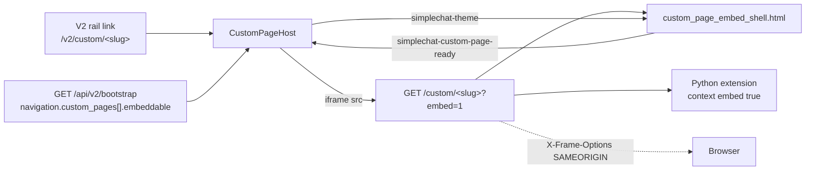

# V2 Custom Pages

**Implemented in version: 0.261.445**, recorded in `application/single_app/config.py`.

## Overview

Custom Pages are trusted pages that a deployment team ships with the application: static HTML,
CSS and JavaScript, or a Python-backed template. The classic interface renders each one at
`/custom/<slug>` inside its own layout, `custom_page_shell.html`, which extends `base.html`.

The V2 interface could list those pages in its rail but could not show them. Every entry was a
plain anchor to the classic page, so each click left V2 and landed in the classic navigation. The
pages cannot be written again as React pages, because the HTML, scripts and extensions are
written by deployers, so V2 now shows them by framing a chrome-less, same-origin copy inside one
of its own pages.

| Question | Before | After |
| --- | --- | --- |
| Where does a same-tab custom page open from the V2 rail? | The classic page, in the classic layout | `/v2/custom/<slug>`, inside V2, with the rail still on screen |
| What is the entry in the rail? | A plain anchor | A router link with an active state |
| What does the page get? | The classic navigation, banner and scripts | Its own HTML, CSS and JavaScript on a Bootstrap base, no classic navigation |
| What if the page cannot be framed? | Not applicable | A short explanation and a link that opens it in its own tab |
| What does the classic interface do? | Renders the classic page | The same, unchanged |

## Dependencies

- `route_custom_pages.py`, `functions_custom_pages.py` and `custom_page_extension.py` for the
  route, the navigation items and the extension contract.
- `app.py` (`add_security_headers`) for the one framing exemption, and `config.py`
  (`SECURITY_HEADERS`) whose values it relaxes and does not change.
- `route_backend_v2.py` (`_build_navigation`) for the `embeddable` flag in the bootstrap payload.
- `functions_ui_mode.py`, the seam that decides between the classic and modern interface. It
  always answers classic today.
- React and TypeScript in `application/v2_ui`. No packages, remote scripts or remote styles are
  added: the embed document loads Bootstrap, Bootstrap Icons, jQuery and `toast.js` from
  `/static`.

## Technical specifications

### Architecture



### Server: the embed request

`_render_custom_page_response` in `route_custom_pages.py` serves the canonical route and the
`.html` alias. Only the exact query `embed=1` asks for the chrome-less copy. `embed=0`,
`embed=true` and every other value render the classic page.

| Request | Response | `X-Frame-Options` |
| --- | --- | --- |
| `/custom/<slug>`, static page | Classic shell | `DENY` |
| `/custom/<slug>?embed=1`, static page | `custom_page_embed_shell.html` | `SAMEORIGIN` |
| `/custom/<slug>?embed=1`, Python page with `supports_embed = True` | The extension's response, with `context["embed"]` set to `True` | `SAMEORIGIN` |
| `/custom/<slug>?embed=1`, Python page without `supports_embed` | The extension's response, with `context["embed"]` set to `False` | `DENY` |
| A page open to any signed-in user, modern interface, no `embed` | The embed shell as a full page | `DENY` |
| Unknown slug, unsafe slug, disabled page, Custom Pages off | `404 Not Found` | `DENY` |
| A page the user's roles do not satisfy | `403 Forbidden` | `DENY` |
| `/custom/assets/...` and every other route | Unchanged | Unchanged |

The 403 and 404 answers, slug validation, the declared-file check and the path traversal guard are
the existing ones and run before any embed decision. The embed flag is set only after a page has
rendered, so an error response is never marked frameable.

### Server: the embed documents

`custom_page_embed_base.html` is a standalone document. It does not extend `base.html`, so it has
none of the classic navigation, notification polling, idle warning, banner or stylesheets. It
provides the Bootstrap 5 stylesheet, Bootstrap Icons, the Bootstrap bundle, jQuery, `toast.js`
(`window.showToast`) and a toast container, all from `/static`, plus two inline scripts: the theme
bootstrap and the conversation with the host (see Messages). It offers the same blocks as the
classic base, `title`, `head`, `content` and `scripts`, and one more, `page_title`, for the slim
bar.

`custom_page_embed_shell.html` extends it for a static page: the declared CSS links, the trusted
page HTML with the same `| safe` boundary and `xss-check: ignore` justification as the classic
shell, and the declared JavaScript modules. It has no hero header. When V2 frames the page, V2's
page header shows the navigation label, and a second title in the frame would repeat it.

A page opened on its own, outside a frame, gets a slim bar with the page title and a link back.
The bar is rendered hidden and revealed by a script when `window.self === window.top`. For a full
page the server already knows is standalone, it is rendered visible, so it does not depend on
script. The link goes to `/v2` for someone with the `User` or `Admin` role and to `/` for anyone
else, because `/v2` answers 403 without the app role.

The theme is taken, in order, from the saved `darkModeEnabled` preference or the administrator's
default (server-rendered), then from local storage (`simplechat.v2.theme`, then
`simplechat-theme`) before the first paint, then from host messages.

### Server: Python-backed pages

`CustomPageExtension` gains a class-level opt-in, `supports_embed`, `False` by default. An
extension that sets it is asked for a chrome-less response with `context["embed"]` set to `True`;
one that does not is never asked, and V2 offers to open it in a new tab. The simplest chrome-less
response extends the embed base:

```jinja

```

`build_custom_page_context` gains the `embed` flag, and `is_custom_page_embeddable` is the single
rule: static pages are embeddable, a Python page only when its extension declares support. The
documented Python example opts in and is exercised in both interfaces by the functional test.

### Server: framing

`config.SECURITY_HEADERS` sends `X-Frame-Options: DENY` and a Content-Security-Policy with
`frame-ancestors 'self'`, plus the Teams origins when Teams SSO is configured. The embed render
sets a request-scoped flag, `allow_same_origin_framing()`, and `add_security_headers` replaces the
header with `SAMEORIGIN` for that one response, and only when the header is present. The
Content-Security-Policy is never touched. Deployments that enable Teams SSO send no
`X-Frame-Options` at all, so nothing is relaxed and nothing is added.

Chromium 145 was checked directly with each combination:

| Headers on the framed document | Same-origin frame |
| --- | --- |
| CSP `frame-ancestors 'self'` and `X-Frame-Options: DENY` | Loads |
| `X-Frame-Options: DENY` alone | Refused |
| CSP `frame-ancestors 'self'` and `X-Frame-Options: SAMEORIGIN` | Loads |
| `X-Frame-Options: SAMEORIGIN` alone | Loads |
| CSP `frame-ancestors 'self'` alone, as under Teams SSO | Loads |

So in Chromium the existing policy already lets the same origin frame a page that carries `DENY`,
because a `frame-ancestors` directive takes precedence over `X-Frame-Options`. The `SAMEORIGIN`
relaxation keeps the legacy header consistent with the policy for the embed document and for any
client that reads `X-Frame-Options` on its own. Every other response keeps `DENY`.

### Server: navigation payload

`_build_custom_pages_nav` adds `embeddable` to each navigation item, and `_build_navigation` in
`route_backend_v2.py` passes it through as one of the six sanitized fields (`slug`, `label`, `icon`,
`url`, `open_in_new_tab`, `embeddable`). An item without the field reads as `false`. The shared
navigation cache key now includes a schema version, `CUSTOM_PAGES_NAV_SCHEMA_VERSION`, so a
rolling deployment never serves items cached before the field existed.

### V2: the host page

`/custom/:slug` in `App.tsx` renders `CustomPageHost`. `lib/customPageEmbed.ts` holds the rules,
so they can be run without a browser. The page must be in the signed-in user's navigation list,
which the server has already filtered by role and by the page being enabled.

| Slug | State |
| --- | --- |
| Not a valid slug (`SLUG_PATTERN`, at most 64 characters), or not in the list, or the group is off | "Page not available", with a link to the home page |
| In the list, `open_in_new_tab` set | "Opens in a new tab", with the link |
| In the list, not `embeddable` | "Opens in a new tab", with the link |
| In the list, but V2 is hosted on a different origin than the API | "Opens in a new tab", with the link |
| In the list, embeddable, same tab | The frame |

The frame loads `/custom/<slug>?embed=1`. It carries `title`, `referrerPolicy="same-origin"` and
`allow=""`, and a sandbox that allows scripts, same-origin access, forms, popups (which leave the
sandbox, so a page opened from a link is not confined), downloads and dialogs, and withholds every
top-navigation permission. The sandbox is a guard rail and not a boundary. The page is trusted
deployment code that calls its own `/api/custom/...` operations with the user's session, so it
needs `allow-scripts` and `allow-same-origin`, and a page with both can lift the rest from the
inside. What the flags still do is stop a stray `target="_top"` link or script from replacing the
whole application. The real controls are the server's authorisation, the framing header and the
origin and sender checks on every message.

The frame fills the area below the page header and the page scrolls inside it. A header action,
**Open in a new tab**, opens the same chrome-less document on its own; see the next section.

### V2: the new-tab links

A framed page has two links to a tab of its own, the header action and the one on the failure
panel. Both open `/custom/<slug>?embed=1`: the chrome-less document by itself, with the slim bar
that links back to V2 and no V2 shell around it. `safeCustomPageStandaloneHref` in
`lib/customPageEmbed.ts` builds the address with the same slug validation and encoding as the
frame's, and both links open it with `noopener` and `noreferrer`.

They do not open the page's classic address, `/custom/<slug>`. When the modern interface is
selected, the classic-to-V2 redirect ([V2 Interface Selection Prerequisites](V2_INTERFACE_SELECTION_PREREQUISITES.md))
sends that address to `/v2/custom/<slug>` for a page V2 can host: one in the user's navigation,
embeddable, not set to open in its own tab, and not open to any signed-in user. A tab opened there
would be a second host, and from the failure panel it would load the same failing frame again. The
route registry excludes `embed=1` from the redirect (`classic_only_query` on the `custom-page` and
`custom-page-html` rows), so the new tab shows the page by itself, or the page's real response when
it cannot be shown: the access error, the missing page, or the sign-in page.

The links that do open a classic address belong to pages V2 does not frame: the **Opens in a new
tab** card, and the rail entry, for a page that asks for its own tab or is not embeddable. The
redirect leaves such a page alone, so the link opens the page itself. The same card appears for
every page when V2 is hosted on another origin than the server, and its link then goes to the
server's origin, where that server's own redirect decides what it shows.

### V2: telling a rendered page from an error page

A frame fires `load` for a 403, a 404 and a server error as well as for the page, so `load` cannot
say that the page rendered. The embed document sends `simplechat-custom-page-ready` to its parent
while it is still being parsed, and the host waits for it.

| State | Meaning | What is shown |
| --- | --- | --- |
| `loading` | The frame has not reported | A loading panel; the frame is hidden |
| `ready` | The page reported | The frame |
| `failed` | `load` fired and 3 seconds passed with no report, or 30 seconds passed with no `load` | "This page could not be loaded", **Try again** and **Open in a new tab**; the frame stays hidden |

A page that reports late replaces the failure panel, because a slow server is not a broken one.
**Try again** remounts the frame, so the page is requested again rather than reloaded. **Open in a
new tab** on the panel opens the page's own response, as described above. The hidden
frame also takes an error page out of the tab order and the accessibility tree. A page that
navigates inside the frame afterwards is not re-checked.

### Messages

The two documents are the same origin and exchange two messages. Each end checks the origin and
the sender.

| Message | Direction | Payload | Accepted when |
| --- | --- | --- | --- |
| `simplechat-custom-page-ready` | page to host | `{type, slug}` | The origin is this site and the sender is the host's own frame |
| `simplechat-theme` | host to page | `{type, theme}` | The origin is this site, the sender is the parent window, and `theme` is `light` or `dark` |

The ready message is addressed to this origin, so another origin cannot receive it. V2 sends the
theme when the page reports in and whenever the reader changes it. The names live in
`lib/customPageEmbed.ts` and in the embed base template, and a test holds the two to each other.

### V2: the rail

`NavExtras.tsx` draws a router link to `/custom/<slug>` for a same-tab page the server marked
embeddable, with the same active styling as the primary navigation, so following it is not a
document load. A page with `open_in_new_tab`, a page that is not embeddable, and every page when V2
is hosted on a different origin keep their anchor to the classic page. External links are unchanged.

### Accessibility

- The frame has a `title`, the V2 page has one `h1` with the navigation label, and the framed page
  adds no second title.
- The loading panel is a status region and the failure panel is an alert.
- Two controls that appear on focus, **Skip to** and **Skip past** the page name, move focus into the
  frame or past it, so a keyboard user does not have to tab through every control the page has.
- The layout holds at 390 px wide, and the framed page does not scroll sideways.

### Files

| File | Role |
| --- | --- |
| `application/single_app/route_custom_pages.py` | Embed decision, both shells, framing flag |
| `application/single_app/functions_custom_pages.py` | `is_custom_page_embeddable`, context `embed`, navigation `embeddable`, cache schema, framing flag |
| `application/single_app/custom_page_extension.py` | `supports_embed` |
| `application/single_app/templates/custom_page_embed_base.html` | Standalone embed document |
| `application/single_app/templates/custom_page_embed_shell.html` | Static page embed shell |
| `application/single_app/app.py` | `add_security_headers` framing exemption |
| `application/single_app/route_backend_v2.py` | `embeddable` in the navigation payload |
| `application/single_app/docs/how-to/custom_pages.md` | Developer guide, served in the app |
| `application/v2_ui/src/pages/CustomPageHost.tsx` | The host page |
| `application/v2_ui/src/lib/customPageEmbed.ts` | Slug, address, state and message rules |
| `application/v2_ui/src/lib/navigationGroups.ts`, `components/layout/NavExtras.tsx` | Router links for embeddable pages |
| `application/v2_ui/src/App.tsx`, `lib/types.ts` | The route and the `embeddable` field |

## Usage

Static pages need nothing: save the metadata and the page appears in V2 at `/v2/custom/<slug>`. A
Python-backed page sets `supports_embed = True` and returns a chrome-less response when
`context["embed"]` is true. To see exactly what V2 frames, open `/custom/<slug>?embed=1` in a tab.
It shows the slim bar there because it is not framed. A page that should leave V2 keeps **Open in
New Tab** on. The developer guide, `application/single_app/docs/how-to/custom_pages.md`, has the
details and the list of globals the embed document provides.

## Testing and validation

- `functional_tests/test_custom_pages_embed_mode.py` renders the real templates and runs the real
  web app in fresh processes with the network blocked: the embed document has no classic chrome and
  carries the declared files, only `embed=1` is honoured, `SAMEORIGIN` appears on a flagged embed
  response and `DENY` everywhere else, the Content-Security-Policy does not change, Teams SSO sends
  and gains nothing, a Python extension is told to embed only when it opted in, a page open to any
  signed-in user is chrome-less in the modern interface and unchanged in the classic one, unsafe
  slugs and 403 and 404 answers are preserved, and the navigation payload carries `embeddable`. It
  also runs the two Node logic tests below. Two tests build V2's links with the real TypeScript and
  put them through the real `evaluate_ui_redirect` and route registry in the modern interface: the
  address behind **Open in a new tab** is not redirected, while the same address without `embed=1`
  is sent to `/v2/custom/<slug>`, and every other link V2 draws to a classic custom page address (the
  rail anchors and the new-tab card) belongs to a page the redirect leaves alone.
- `functional_tests/test_v2_custom_page_host_logic.mjs` runs the host rules: which slugs and pages
  are framed, the new-tab address (the `embed=1` pair, one validated segment, a hostile slug refused),
  message validation, and the state transitions. `test_v2_navigation_groups_logic.mjs`
  runs the rail's mapping.
- `ui_tests/test_v2_custom_pages.py` drives real Chromium against the built V2 bundle and the real
  embed template. It checks that the frame loads and fills the pane while the rail stays, that the
  page's CSS, script and API call work, the rail's active state, theme sync and refused foreign
  messages, "Page not available", the new-tab states, 403, 404 and 500 handling, **Try again**, a
  late report, keyboard use, the standalone bar, and a 390 px viewport. Every response carries the
  application's security headers, so the browser accepts or refuses the frame as it does in
  production. The fixture also answers each `/custom/<slug>` navigation the way the modern
  interface's redirect does, using the application's own function. At desktop and phone widths the
  header action and the failure panel link must open `/custom/<slug>?embed=1`, and the tab that
  opens must show the page by itself, or the real 403, and never the V2 shell.

## Known limitations

- A link inside a framed page that names a classic page, such as `/chats`, loads that page inside
  the frame. Links that should leave the page need `target="_blank"`; `target="_top"` is blocked by
  the sandbox. The classic-to-V2 redirect ([V2 Interface Selection Prerequisites](V2_INTERFACE_SELECTION_PREREQUISITES.md))
  deliberately skips a request made by a frame, so it never loads V2 inside V2.
- The embed document does not load the classic stylesheet or scripts and does not define
  `window.appSettings` or `window.userContext`. A page that depends on them should fetch its own
  data or stay on **Open in New Tab**.
- A page that is slow to parse can show the failure panel for a moment before it recovers.
- The page applies the saved or stored theme first and V2's choice a moment later. They differ only
  when V2 is following the operating system's color scheme and nothing has been saved.
- `/v2/custom/<slug>.html` is not a V2 address; the slug is the whole segment.
- V2 reads the user's navigation list, so a page whose **Show in Navigation** setting is off is not
  a page V2 can host. `/v2/custom/<slug>` answers "Page not available" for it, and the page stays
  reachable at its classic address.
- The interface selector is not built, so `get_ui_mode()` always answers classic and the
  chrome-less full page for people without the app role is not reachable yet. It is covered by
  tests that replace the selector.
- When V2 is hosted separately from the server, a frame would be cross-origin, so pages open in a
  new tab.
