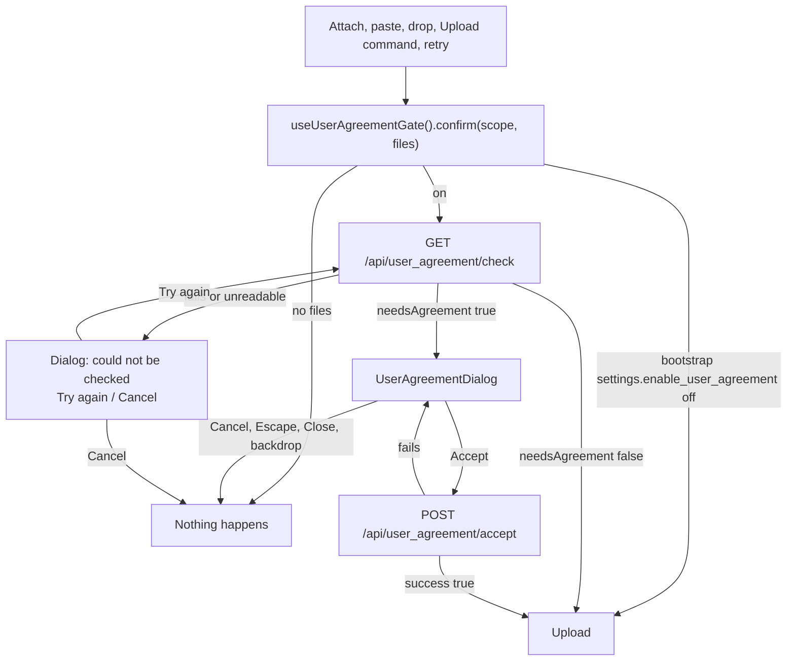

# V2 User Agreement Gate

**Implemented in version: 0.261.445**, recorded in `application/single_app/config.py`.

## Overview

An administrator can require a **User Agreement** before people upload files
(Admin Settings > Appearance > Notices & Agreements > User Agreement, setting
`enable_user_agreement`). Classic enforces it in the browser: `static/js/user-agreement.js`
asks the server whether an agreement applies, shows it, records the acceptance and only then
sends the files. No upload route checks it, so the browser is the whole control.

V2 had only the administrator's *preview* of that dialog. Nothing in V2 called the check or
accept routes, so a V2 user could upload into a workspace or a chat without ever being shown
the agreement. V2 now asks before every upload it makes, for the same scopes and with the same
parameters as classic.

| Capability | V2 before this change | V2 after this change |
| --- | --- | --- |
| Agreement shown before a chat upload | Never | Attach, paste, drop and retry |
| Agreement shown before a workspace upload | Never | Upload command, file input and drop, in personal, group and public workspaces |
| Acceptance recorded | Never | `POST /api/user_agreement/accept`, in the same activity log classic writes |
| "Accept once per day" | Not applicable | Honoured, and shared with classic |
| A check or an acceptance that fails | Not applicable | The upload is held and the person is told; classic lets it through |
| A check or an acceptance that never answers | Not applicable | Fails after 20 seconds like any other failure, so it cannot hold Send or the dialog for good |
| Send while a file is waiting on the agreement | Not applicable | Held, with the reason said in words, so a message never goes without the file it was written for |
| The elicitation card's Next, Review answers and Use these answers while a file is waiting | Not applicable | Held the same way, with the reason said under the buttons |

## Dependencies

- `route_backend_user_agreement.py`: `GET /api/user_agreement/check` and
  `POST /api/user_agreement/accept`. Unchanged.
- `functions_activity_logging.py`: `log_user_agreement_accepted()` and
  `has_user_accepted_agreement_today()`. Unchanged.
- Settings `enable_user_agreement`, `user_agreement_text`, `user_agreement_apply_to` and
  `enable_user_agreement_daily`. Unchanged. `enable_user_agreement` also reaches V2 in the
  bootstrap payload's sanitized `settings`, as it reaches classic's templates.
- React/TypeScript V2 UI, the shared `Modal` and `PlainMarkdown`. No new packages and no new
  browser asset sources.

## Technical specifications

### Architecture

### Files

| File | Purpose |
| --- | --- |
| `application/v2_ui/src/lib/userAgreement.ts` | The client for the two routes: scope naming, `checkUserAgreement`, `acceptUserAgreement`, the pure `agreementGateDecision` and `userAgreementSwitchedOn`, the failure wording, and the one time limit, `USER_AGREEMENT_REQUEST_TIMEOUT_MS`, that bounds both requests |
| `application/v2_ui/src/lib/useUserAgreementGate.ts` | The hook. Returns `confirm(scope, files)` and `withAgreement(scope, files, proceed)`, the dialog's state, and `pending`, which is true while any gate that needs the check has not settled. Serializes gates, ends a gate with "do not upload" when its owner unmounts |
| `application/v2_ui/src/components/ui/UserAgreementDialog.tsx` | The dialog, built on the shared `Modal` and `PlainMarkdown` |
| `application/v2_ui/src/components/chat/ComposerEditor.tsx` | Chat entry point: gates `enqueueSelectedFiles` and `retryUpload`, says in words that the agreement is being checked, ignores Enter meanwhile, and reports `pending` to its owner through `onAgreementPendingChange` |
| `application/v2_ui/src/components/chat/Composer.tsx` | Holds Enter, Send and the large-run Continue while the editor reports `pending` |
| `application/v2_ui/src/components/chat/ElicitationCard.tsx` | Holds Next, Review answers, Use these answers and Enter while any field's editor reports `pending`, and says why under the buttons |
| `application/v2_ui/src/components/documents/DocumentExplorer.tsx` | Workspace entry point: gates `onUploadFiles` |

### Upload entry points

Every place V2 hands a user's file to the server goes through one of two components, and each uses the
gate. `functional_tests/test_v2_user_agreement_gate.py` lists every module that builds a multipart body
and fails when a new one appears without being classified, so a new upload path cannot be added
unguarded.

| Entry point | What starts an upload | Scope sent to the server |
| --- | --- | --- |
| `ComposerEditor.tsx` | The **Attach file** button, pasting a file into the message box, dropping a file on it, and **Retry** on a failed upload | `chat`, workspace id `default` |
| `DocumentExplorer.tsx` in My workspace | The **Upload** command, the hidden file input, dropping files on the document list | `personal`, workspace id `default` |
| `DocumentExplorer.tsx` in a group workspace | The same | `group`, the group's id |
| `DocumentExplorer.tsx` in a public workspace | The same | `public`, the public workspace's id |

These are the pairs classic sends from `chat-input-actions.js`, `workspace-documents.js`,
`group_workspaces.html` and `public_workspace.js`. The match matters: "accept once per day" is answered
from the activity-log records those routes write, keyed by workspace type and workspace id, so an
acceptance made in either interface counts in the other only if both name the workspace the same way.

Not gated, because they are not a person's document or chat upload and classic does not gate them
either: administrator branding images, OpenAPI specifications uploaded while configuring an action,
group and public workspace logos, recorded speech sent for transcription, and credential forms.

### Parameters

| Request | Sent |
| --- | --- |
| `GET /api/user_agreement/check` | Query `workspace_type` (`chat`, `personal`, `group` or `public`), `workspace_id`, `action_context=file_upload`. Sent with `cache: no-store` |
| `POST /api/user_agreement/accept` | JSON `workspace_type`, `workspace_id`, `action_context` |

The check answers `needsAgreement`, `agreementText` and `enableDailyAcceptance`. The accept answers
`success`.

### When V2 asks

1. **No files.** Nothing is uploaded and nothing is asked.
2. **The switch is off.** Classic loads its agreement script only when `enable_user_agreement` is on. V2
   reads the same switch from the bootstrap payload and sends no request when it is off or absent, so a
   deployment that does not use the feature pays nothing and gains no new way to fail. Any other value is
   treated as possibly on, and the server decides.
3. **The switch is on.** V2 asks the server, which knows the scopes the agreement applies to and whether
   the person has already accepted today.
4. **Only files that will be sent.** The documents explorer applies its permission, type and size checks
   first, and the composer applies its type and size checks first, so a file that is refused locally never
   triggers the agreement.

### When something fails

Classic fails open: a check that errors, and an acceptance the server could not record, both let the
upload carry on. For a compliance control that is the wrong default, so V2 **fails closed**:

| What failed | What the person sees | What is uploaded |
| --- | --- | --- |
| The check (network error, any non-2xx answer, an answer that does not say whether an agreement applies, or no answer within 20 seconds) | A dialog, "User agreement could not be checked", with **Try again** and **Cancel** | Nothing until a check succeeds |
| The acceptance (the same, including no answer within 20 seconds) | The agreement stays open with an alert, "Your acceptance could not be recorded, so nothing was uploaded", and focus returns to **Accept** | Nothing until an acceptance is recorded |

The server's own error text is never shown; only the status code is, or, for a request that did not answer,
"(no answer within 20 seconds)".

### The time limit

`request()` has no time limit of its own, so a check or an acceptance that never answered would hold the upload
for good: a check holds Send, and an acceptance holds the dialog, whose **Cancel** is ignored while one is in
flight. `checkUserAgreement` and `acceptUserAgreement` therefore each run under one limit,
`USER_AGREEMENT_REQUEST_TIMEOUT_MS`, which is 20 seconds, far longer than either takes.

- The request gets an `AbortController` of its own that follows the caller's signal (the gate aborts a request
  when its owner goes away) and is also aborted when the time runs out. No new package or browser API is used.
- A request that runs out of time rejects with `UserAgreementTimeoutError` and takes the path of any other
  failure: `agreementFailureMessage` says the check or the acceptance could not be completed, and the dialog
  offers **Try again** and **Cancel**. A timed-out check shows "User agreement could not be checked" and **Cancel**
  releases Send. A timed-out acceptance leaves the agreement open, enables both buttons again, and reports
  nothing as accepted, whatever the server went on to do with the request.
- An abort by the caller is not a timeout, and a request that answers in time leaves no timer running.
- Every try has a limit of its own, so **Try again** gets a fresh 20 seconds.

### Dialog behavior

- **Accept** records the acceptance, then the upload starts. **Cancel**, **Escape**, the close button
  and a click on the backdrop all mean "do not upload". None of them changes what the person had in the
  composer or the explorer; a cancelled retry leaves the failed file in the list to try again later.
- While the acceptance is being recorded both buttons are disabled and the dialog ignores Escape and the
  backdrop, so an acceptance in flight is never also reported as declined. That lasts at most 20 seconds
  (see the time limit above).
- The shared modal traps focus, returns it to the control that opened the dialog, and is a named dialog
  ("User Agreement Required"). The agreement text is a labelled, focusable region so it can be scrolled
  with the keyboard. It fits a 390 px wide screen.
- When the administrator has enabled once per day, the dialog adds "Your acceptance will be remembered for
  today."
- The agreement is rendered by `PlainMarkdown`, the renderer the administrator's own preview uses. It
  renders Markdown but never raw HTML, so agreement text cannot inject markup. Classic renders the HTML
  that Markdown produces after sanitizing it, so a deployer who wrote raw HTML into the agreement will see
  it as plain text in V2, exactly as the preview in Admin Settings shows it.
- Links in the agreement open in a new tab, so following one does not discard the upload.

### While the agreement is being settled

A file has no chip in the composer until its gate settles, so for that wait nothing in the draft says an
upload is coming. Left alone that is a window, and it lasts for the check's round trip and for as long as a
person takes to read the agreement. A message sent in it goes without its file, and in a new chat the send
assigns the conversation, so the file that arrives afterwards finds the composer in a conversation it was not
chosen for and has nowhere to go.

The hook closes the window with `pending`, a boolean on the gate:

- It is raised the moment a `confirm` or `withAgreement` that needs the check is queued, and lowered when that
  gate's promise settles, however it settles: no agreement applies, Accept, Cancel, a failed check that is
  then cancelled, or the owner unmounting. It counts gates, so two that overlap keep it raised until both are
  done.
- It is never raised for a gate that is answered at once, which is every gate when the switch is off and every
  call with no files. With the feature off nothing changes on screen, not even for a frame, and no request is
  made.
- State changes after the owner has unmounted are dropped, and an owner that is shown again reads the flag
  afresh, so it cannot stay raised for a gate that ended while the owner was away.

What the person sees and can do in the chat composer while it is raised:

| | While a file waits on the agreement |
| --- | --- |
| Send | Disabled. Its title, and so its accessible description, says "Checking the user agreement before attaching your file…" |
| Enter in the message box | Does nothing. The message stays where it was |
| Status text | The same sentence, as status text under the message box, in the place where the file's chip will appear |
| Large-run **Continue** and **Send anyway** | Held with Send |
| After the check says no agreement applies, or after **Accept** | The chip appears and the file uploads. Send is released once the upload has finished, as for any upload |
| After **Cancel** | Everything is released. The message is as it was and nothing was uploaded |

`ComposerEditor` reports the flag upward through the optional `onAgreementPendingChange` prop. It does so from
a layout effect, so the owner holds its Send in the same commit that raises the flag, and the effect's cleanup
reports `false`, so an editor that goes away cannot leave its owner held. `Composer` adds the flag to
`uploadsBlocked`, which `submit()`, Enter, the large-run dialog's Continue and the Send button already read.
The editor also ignores Enter itself while the flag is up, so an owner that does not read the flag is still not
sent early by the keyboard.

If the person leaves the conversation while the check is still running, the gate carries on. The composer in
the new conversation is held until it settles, normally a fraction of a second, or until the dialog is answered
or the check runs out of time. The file is not attached to a conversation it was not chosen for, and a message
says so: "Your file was not attached because you left the conversation. Attach it again here."

### In the elicitation card

A question field in `ElicitationCard.tsx` embeds the same editor, so a file chosen in one waits on the agreement
before it has a chip too, and the card's controls would otherwise move on, or send the answers, without it.

- Each field reports through `onAgreementPendingChange`. The card keeps the names of the fields that are holding
  in a `Set` in its state, declared with its other hooks ahead of its early returns, and `canAdvance` and
  `canFinish` include "no field is holding". The **Next**, **Review answers** and **Use these answers** button,
  `advance()`, `send('accept')` and the Enter that reaches them are all read from those two conditions, so all
  of them wait.
- The line under the buttons says why, in the style it already uses for "Wait for the attached files to finish
  processing": "Checking the user agreement before attaching your file…".
- **Continue without answers**, **Cancel and abandon this request** and **Back** are not held. A field that goes
  away, because the person went back or to another step, releases its hold when its editor unmounts, and a
  new question or a new revision of the same one starts with nothing held, so a name cannot outlive its field.
  The file that was waiting in a field that went away is not sent, and nothing says so.
- Use these answers sits on the review page, where no field is mounted, so it can never be reached while a file
  waits; the hold is on the page that has the field.

`AssistThread.tsx`, the only other component that renders the shared editor, renders it `restricted`. That
switches uploads off (`uploadsEnabled` includes `!restricted`), `enqueueSelectedFiles` returns before it reaches the
gate, paste and drop return early, the file input and the Attach buttons are not rendered, and the Retry button is
disabled, so no file can wait there and `pending` is never raised.

### Concurrency

Gates run one at a time per component. A second drop while the first is being settled waits its turn
instead of stacking a second dialog, and `pending` stays raised across the wait: with two files dropped in
quick succession Send stays held after the first file has been attached, until the second has been attached
too. Clicking **Retry** twice starts one upload. If the component unmounts while the agreement is open, the
upload does not start. If the composer moves to another conversation, the file is not attached there, as
described above.

## Usage

### For administrators

Nothing new to configure: Admin Settings > Appearance > Notices & Agreements > User Agreement is unchanged.
When the agreement is enabled for a scope it now applies in V2 as it does in classic. See
[Appearance settings](../../admin/appearance.md#user-agreement-section).

### For users

Choose, paste or drop files as usual. If an agreement applies, a dialog shows it before anything is
uploaded. **Accept** continues with the upload; **Cancel** leaves everything as it was. See
[Upload and manage documents](../../guides/upload-and-manage-documents.md) and
[Upload documents in chat](../../guides/upload-documents-in-chat.md).

## Testing and validation

- `functional_tests/test_v2_user_agreement_gate.py`: the client against the route source, workspace
  naming against classic's call sites, the classified list of multipart senders and callers, the order of
  the checks in the composer and the explorer, the dialog's safe rendering, that the composer and the
  elicitation card hold their controls from `pending` (every component that renders the shared editor is
  classified, and the assist thread is shown to be unable to reach the gate), that both requests go out only
  through the one time limit, and the TypeScript logic below.
- `functional_tests/test_v2_user_agreement_gate_logic.ts`: scope naming, when to ask, how an answer is
  read, and the request each route is sent, executed with `fetch` replaced. It also runs the gate hook
  itself, on the small hooks runtime in `functional_tests/test_support/miniReactHooks.ts` because there is no
  DOM to render it in, and checks `pending`: never raised for a gate answered at once, raised from the moment
  a gate is queued, kept up across overlapping gates and an open dialog, a failed acceptance or a failed
  check, and lowered on Accept, on Cancel, on unmount (queued gates included, with no state change after
  it) and when an owner that was hidden is shown again. For the time limit it takes over only that timer, so
  nothing waits 20 seconds: a check and an acceptance that never answer fail with `UserAgreementTimeoutError`
  and their request is abandoned, an answer in time or an abort by the caller leaves no timer running and is
  not a timeout, and through the hook a timed-out check shows the failure and Cancel releases it, a timed-out
  acceptance is not reported as accepted and can be cancelled or made again, and Try again gets a fresh limit.
- `ui_tests/test_v2_user_agreement_gate.py`: the real composer editor, the whole chat composer, the real
  elicitation card and the real documents explorer in Chromium with only HTTP answered: the prompt before a
  chat or workspace upload, Accept, Cancel and Escape, once-per-day, a failed check, a failed acceptance, a
  request in flight, paste, drop, retry, leaving mid-agreement, keyboard focus, link handling, and a 390 px
  viewport. For the Send hold,
  with the check delayed: Enter pressed while it runs sends nothing, Send is disabled with its reason, and
  once the check answers the chip appears, the file uploads and the message then goes with it, in a new chat
  and an open conversation at desktop and 390 px, and whether the file was pasted, chosen or dropped; Enter
  pressed on every animation frame across the moment the check answers never sends before the file is
  attached; an open dialog and a failed check keep Send held and Cancel releases it, at both widths; two
  quick drops hold Send until both files have arrived; leaving the conversation mid-check leaves the
  composer usable and says the file was not attached; an editor that goes away lowers the flag for its
  owner; the editor ignores Enter itself while a file waits; and with the switch off Send is never held and
  the wording never reaches the page. For the elicitation card, with the check delayed: Next, Review answers
  and Enter move nowhere and the hint says why, Continue without answers stays available, and once the check
  answers the chip appears and the button works through to the answers being sent; an open dialog holds the
  card and Cancel releases it; Back releases a hold, as does a new revision of the question; and with the
  switch off the card is never held. For the time limit, on a faked page clock that is jumped forward, never
  waited out: a check that never answers shows the failure after 20 seconds and Cancel releases Send, Try
  again asks again with a fresh limit, and an acceptance that never answers shows its failure, reports
  nothing as accepted, and leaves a dialog that can be cancelled.
- The existing upload suites run with the switch off, which sends no request, and are unaffected: chat
  paste, drop and image uploads, and personal, group, public and OneNote workspace uploads.

## Known limitations

- **The control is in the browser, as in classic.** The upload routes do not check that an agreement was
  accepted, so a client that calls them directly is not stopped. Enforcing it on the server is a separate
  piece of work.
- **A file that is waiting when its field goes away is dropped without a message.** In the elicitation card,
  going back or to another step while a file waits on the agreement unmounts the field, which ends the gate
  with "do not upload", so the file is not sent and nothing says so. The chat composer, by contrast, says so
  when the person leaves the conversation.
- **Chat uploads that land in a group workspace are gated as `chat`**, because that is the scope classic
  sends. An agreement applied to groups but not to chat does not appear for them.
- **The switch is read from the bootstrap payload.** An administrator's change reaches a V2 tab that is
  already open when the payload next refreshes (V2 refreshes it when the tab regains focus) or on reload,
  as classic picks it up on the next page load. Once the switch is on, the server is asked on every upload,
  so the agreement text and the daily acceptance are always current.
- **Raw HTML in the agreement text is not rendered** (see above).
- **Generated-file actions** that add an artifact to a workspace are not uploads of a person's file and are
  not gated, as in classic.
