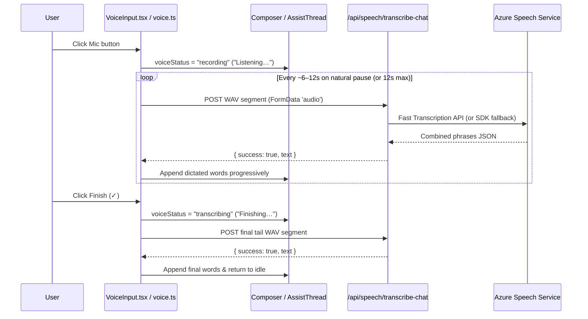

# V2 Voice Dictation Speedup and Ask AI Integration

**Implemented in version:** **0.261.386** (`application/single_app/config.py`)

**Bootstrap selector fixed in version:** **0.261.388** (`application/single_app/config.py`)

## Overview

SimpleChat's V2 interface (`application/v2_ui`) supports push-to-record voice dictation in both the main Chat composer and all conversational **Ask AI** panels. For longer recordings (15–90 seconds), the V2 voice pipeline combines two speed and usability improvements while keeping the existing `/api/speech/transcribe-chat` endpoint and Azure Speech Service configuration:

1. **Same-Endpoint Azure Speech Fast Transcription API**: `/api/speech/transcribe-chat` uses Azure Speech's synchronous Fast Transcription REST API (`/speechtotext/transcriptions:transcribe?api-version=2024-11-15`) on the configured `speech_service_endpoint` (supporting both Subscription Key and Managed Identity authentication) and automatically falls back to `speechsdk.SpeechRecognizer` continuous recognition in Azure Government, custom clouds, or regions where Fast Transcription is unavailable.
2. **Progressive Pause-Aware Dictation & Clear Status UX**: While the user speaks, the browser captures 16 kHz mono PCM audio via the Web Audio API, displays a live 5-bar microphone level meter and inline `Listening…` indicator, and flushes natural speech segments (~6–12 seconds) in the background so words appear progressively in the input box as the user talks.

## Technical Specifications

### Architecture Overview

### Key Files

| File | Responsibility |
|------|----------------|
| `application/single_app/route_backend_speech.py` | `/api/speech/transcribe-chat` route using `_transcribe_audio_with_fast_api` with automatic fallback to `_transcribe_wav_with_speech_sdk`. |
| `application/v2_ui/src/lib/voice.ts` | 16 kHz mono WAV encoding (`encodeWav`, `pcmChunksToWav`), live RMS & 5-bar level computation (`computeRms`, `computeAudioLevelBars`), pause-aware flush logic (`shouldFlushSpeechSegment`), progressive text append/rollback (`appendDictatedText`, `revertDictatedSegments`), and cancellable `transcribeAudio`. |
| `application/v2_ui/src/components/chat/VoiceInput.tsx` | Recording pill with live 5-bar waveform and timer, `Finishing…` status pill with cancel support, session rollback on cancel, and inline `Last clip failed · Retry` recovery pill. |
| `application/v2_ui/src/components/chat/ComposerEditor.tsx` | Inline `Listening…` and `Finishing…` status indicator below the textarea during active dictation. |
| `application/v2_ui/src/components/chat/Composer.tsx` | Main V2 chat composer integration with progressive transcript insertion and cancel rollback. |
| `application/v2_ui/src/components/chat/AssistThread.tsx` | Shared V2 Ask AI composer integration, enabling voice dictation across Agent, Action, Workflow, Orchestration Plan, Diagram, Chart, Image, and M365 Pending Action Ask AI panels. |

### Configuration Options

No new admin settings are required. Voice dictation in Chat and Ask AI is governed by the existing `enable_speech_to_text_input` setting and uses the shared Azure Speech Service settings (`speech_service_endpoint`, `speech_service_locale`, `speech_service_authentication_type`, and `speech_service_key` / Managed Identity).

The shared Ask AI composer reads this flag from `useBootstrapStore`'s `data.features`
payload. Version **0.261.388** corrects an invalid `state.bootstrap` selector that
caused TypeScript error TS2339 and blocked the V2 production build, including the
Docker build run by the AZD predeploy hook. No deployment configuration changes
are required.

## Usage Instructions

1. Enable **Enable Voice Input (Speech-to-Text)** in **Admin Settings → Audio & Video**.
2. In V2 Chat or any **Ask AI** panel (Agent Editor, Action Editor, Workflow Editor, Plan Editor, Diagram/Chart/Image Editor, or Pending Action Review), click the **Microphone** button.
3. Speak naturally:
   - The recording pill displays a live 5-bar audio level meter and elapsed timer.
   - The input area displays `Listening…` and progressively inserts transcribed phrases as you pause between sentences.
4. Click **Check (`✓`)** to finish recording:
   - The pill displays `Finishing…` with an elapsed timer while the final few seconds are transcribed.
5. Click **Cancel (`✕`)** at any point during recording or finishing to abort transcription and roll back any text dictated during that recording session.
6. If a network or service error occurs on the final clip, click **Retry** in the inline `Last clip failed` pill to re-transcribe without re-recording.

## Testing and Validation

- `functional_tests/test_v2_voice_dictation_and_ask_ai.py`
  includes a regression check for the shared Ask AI composer's bootstrap selector.
- `functional_tests/test_v2_voice_dictation_logic.mjs`
- `functional_tests/test_missing_swagger_routes_fix.py`
- `functional_tests/test_route_authentication_audit_findings_fix.py`

Run `npm run build` from `application/v2_ui` to validate TypeScript and generate
the production bundle before retrying deployment.
