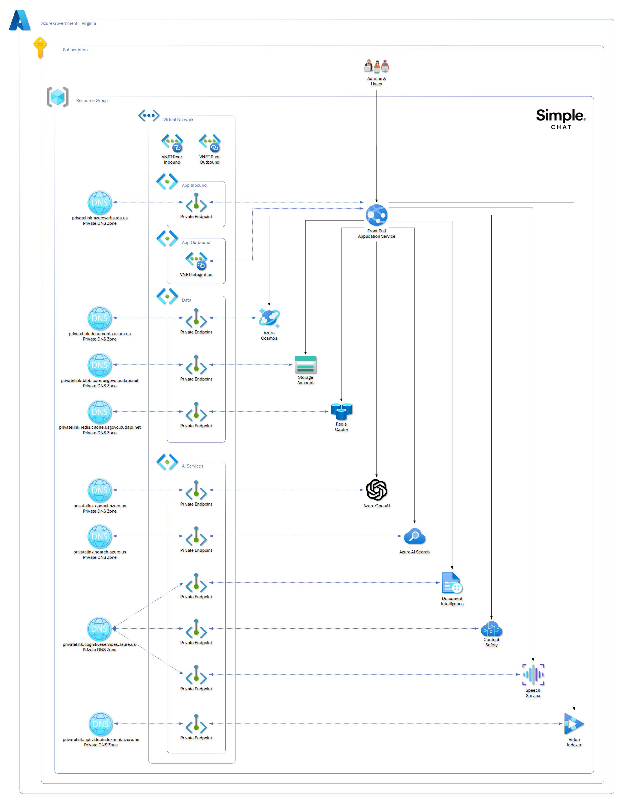

Enterprise networking changes the deployment story as much as the runtime story. The main job is to keep the deployment runner, App Service, and Azure dependencies all able to reach one another while you progressively close off public access.

<section class="latest-release-card-grid">
      <article class="latest-release-card">
            <div class="latest-release-card-icon"><i class="bi bi-map"></i></div>
            <h2>Plan the VNet shape first</h2>
            <p>Subnet design, delegation, and IP planning should be settled before you start placing private endpoints or integrating App Service.</p>
      </article>
      <article class="latest-release-card">
            <div class="latest-release-card-icon"><i class="bi bi-hdd-network"></i></div>
            <h2>Private-endpoint every dependency</h2>
            <p>Cosmos DB, Azure OpenAI, Search, Storage, and other services need a consistent private-connectivity plan rather than one-off exceptions.</p>
      </article>
      <article class="latest-release-card">
            <div class="latest-release-card-icon"><i class="bi bi-diagram-2"></i></div>
            <h2>DNS and route-all are part of the feature</h2>
            <p>Private DNS zones and VNet routing are what make private endpoints usable from the app, not optional polish you add later.</p>
      </article>
      <article class="latest-release-card">
            <div class="latest-release-card-icon"><i class="bi bi-door-closed"></i></div>
            <h2>Disable public access last</h2>
            <p>Only shut off public paths after validating name resolution, App Service connectivity, and deployment-runner reachability.</p>
      </article>
</section>

<div class="latest-release-note-panel">
      <h2>Start with the deployment runner question</h2>
      <p>Before you touch private endpoints, decide whether the machine running the deployment can already resolve and reach the private network path. That answer determines whether you leave <code>allowedIpAddresses</code> blank or temporarily allow a public egress IP during rollout.</p>
</div>

## Overview

Enterprise networking for Simple Chat involves:
- **Private Endpoints**: Secure connections to Azure services
- **Virtual Networks (VNets)**: Isolated network environments  
- **Subnets**: Segmented network spaces for different components
- **Private DNS Zones**: Internal name resolution

### Networking in Azure Commercial


**Fresh deployment defaults:** With private networking enabled and no existing VNet or subnet IDs supplied, Bicep/AZD, Terraform, and the Azure CLI script create the following network. Terraform and CLI address ranges can be overridden; these are their defaults.

| Network/Subnet | Address space | Addresses | Azure-usable | Delegation / Notes |
|---|---|---:|---:|---|
| **VNet** | **`10.0.0.0/21`** | **2048** | - | Fresh deployment; no existing network supplied |
| `AppServiceIntegration` | `10.0.0.0/24` | 256 | 251 | `Microsoft.Web/serverFarms`; outbound only |
| `PrivateEndpoints` | `10.0.2.0/24` | 256 | 251 | All created private endpoints, including app inbound and optional AMPLS |
| **Unallocated** | **`10.0.1.0/24`, `10.0.3.0/24`, `10.0.4.0/22`** | **1536** | - | Reserved for future subnets |

**Compact existing-network reference:** This is a segmented design for an enterprise-managed network, not the automatic output of the scripts.

| Network/Subnet | Address space | Addresses | Azure-usable | Delegation / Notes |
|---|---|---:|---:|---|
| **VNet** | **`10.42.0.0/24`** | **256** | - | Example nonoverlapping enterprise allocation |
| `snet-app-outbound` | `10.42.0.0/26` | 64 | 59 | `Microsoft.Web/serverFarms`; App Service integration |
| `snet-platform-pe` | `10.42.0.64/26` | 64 | 59 | ACR, Key Vault, optional AMPLS |
| `snet-data-pe` | `10.42.0.128/27` | 32 | 27 | Cosmos DB, Blob Storage, optional Managed Redis |
| `snet-ai-pe` | `10.42.0.160/27` | 32 | 27 | OpenAI, Search, Document Intelligence; optional Content Safety, Speech, Video Indexer |
| `snet-app-inbound-pe` | `10.42.0.192/28` | 16 | 11 | Primary App Service private endpoint |
| **Unallocated** | **`10.42.0.208-10.42.0.255`** | **48** | - | Future growth; divisible into `/28` and `/27` blocks |

### Networking in Azure Government



**Fresh deployment defaults:** With private networking enabled and no existing VNet or subnet IDs supplied, all three deployers create the same network shape as Commercial. DNS zones and optional service availability differ.

| Network/Subnet | Address space | Addresses | Azure-usable | Delegation / Notes |
|---|---|---:|---:|---|
| **VNet** | **`10.0.0.0/21`** | **2048** | - | Fresh deployment; no existing network supplied |
| `AppServiceIntegration` | `10.0.0.0/24` | 256 | 251 | `Microsoft.Web/serverFarms`; outbound only |
| `PrivateEndpoints` | `10.0.2.0/24` | 256 | 251 | All supported private endpoints, including optional Government AMPLS |
| **Unallocated** | **`10.0.1.0/24`, `10.0.3.0/24`, `10.0.4.0/22`** | **1536** | - | Reserved for future subnets |

**Compact existing-network reference:** Use classic Azure Cache for Redis instead of Managed Redis, and do not assume a Government Video Indexer private endpoint exists.

| Network/Subnet | Address space | Addresses | Azure-usable | Delegation / Notes |
|---|---|---:|---:|---|
| **VNet** | **`10.42.0.0/24`** | **256** | - | Example nonoverlapping enterprise allocation |
| `snet-app-outbound` | `10.42.0.0/26` | 64 | 59 | `Microsoft.Web/serverFarms`; App Service integration |
| `snet-platform-pe` | `10.42.0.64/26` | 64 | 59 | ACR, Key Vault, optional Government AMPLS |
| `snet-data-pe` | `10.42.0.128/27` | 32 | 27 | Cosmos DB, Blob Storage, optional classic Redis |
| `snet-ai-pe` | `10.42.0.160/27` | 32 | 27 | OpenAI, Search, Document Intelligence; Content Safety/Speech where available |
| `snet-app-inbound-pe` | `10.42.0.192/28` | 16 | 11 | Primary App Service private endpoint |
| **Unallocated** | **`10.42.0.208-10.42.0.255`** | **48** | - | Future growth; divisible into `/28` and `/27` blocks |

Azure reserves five addresses **per subnet**, not per VNet. Unallocated counts are raw addresses; reservations apply when those ranges become subnets. AMPLS requires at least 11 private IPs and a `/27` or larger subnet; `/26` is recommended when sharing with platform endpoints. ACR consumes at least two IPs and Cosmos DB consumes a global IP plus regional IPs. Budget for replicas, additional regions, and future endpoints.

### Script Deployment Versus Reference Segmentation

The current scripts accept **one** App Service integration subnet and **one shared** private endpoint subnet. Supplying an existing VNet does not distribute private endpoints among the five reference subnets. To implement the compact segmented diagram, customize endpoint subnet assignments in IaC or provision them through enterprise network tooling. PaaS services remain outside the VNet; their private endpoint NICs occupy these subnets. Private DNS zones are linked to the VNet, not placed inside subnets.

| Dependency | Bicep/AZD private endpoint | Terraform / Azure CLI | Compact reference placement |
|---|---|---|---|
| Primary App Service | Yes, inbound | Yes, inbound | App inbound |
| Cosmos DB NoSQL, Blob Storage | Yes | Yes | Data |
| Azure Container Registry, Key Vault | Yes | Yes | Platform |
| OpenAI, AI Search, Document Intelligence | Yes; external OpenAI needs resource metadata | Yes; external OpenAI needs resource metadata | AI |
| Redis | Optional; Managed in Commercial, select `classic` in Government | Not provisioned | Data |
| Content Safety, Speech | Optional; subject to regional availability | Not provisioned | AI |
| Video Indexer | Optional PE in supported Commercial API profile; no Government PE | Same cloud limitation | AI only where PE supported |
| AMPLS | Optional, default off in both clouds | Optional, default off in both clouds | Platform |

Endpoint entries assume private networking and the corresponding optional resource are enabled. Separate Foundry project/Agent Service runtime networking and optional native/V2 frontend inbound endpoints are not provisioned by this networking module.

## Prerequisites

- Azure subscription with network administrator permissions
- Simple Chat already deployed (can be reconfigured for private networking)
- Understanding of Azure networking concepts
- Planning for IP address ranges and network topology

## Deployment Runner Connectivity

For enterprise deployments, the important question is whether the machine running `azd up` can already reach the private endpoints for Cosmos DB, Azure Container Registry, and the other protected services.

Leave `allowedIpAddresses` blank when:
- The deployment runner is on a corporate network with routing to the private LAN or connected VNet.
- The deployment runner is connected through VPN or ExpressRoute and can resolve the private DNS zones.
- The deployment runs from a jump host, build agent, or management workstation already inside the private network boundary.

Provide `allowedIpAddresses` when:
- Private networking is enabled.
- The machine running `azd up` must temporarily reach protected services over a public path during deployment.
- Cosmos DB or Azure Container Registry still need a temporary allowlist entry for the deployment runner before public access is disabled at the end of the workflow.

When a value is needed, provide the public egress IP address or CIDR that Azure sees for the deployment runner. In many enterprises this is a company NAT or proxy address, not the laptop's local `10.x.x.x`, `172.16.x.x` to `172.31.x.x`, or `192.168.x.x` address.

If you are unsure which public egress IP is being used, run the lookup from the same machine and network path that will execute `azd up`, for example by searching `what is my IP` in Bing.

## Step 1: Plan Your Network Architecture

### Network Topology Planning

Choose between the fresh-deployment defaults and compact enterprise reference above. Avoid ranges overlapping corporate networks, VPNs, or peered VNets. App Service inbound endpoints must not use the delegated outbound subnet.

**Consider connectivity requirements:**
- On-premises connectivity (ExpressRoute/VPN)
- Multi-region deployment needs
- Integration with existing networks
- Compliance and security requirements

### Service Endpoint Requirements

**Services requiring Private Endpoints:**
- Azure App Service (inbound)
- Azure OpenAI
- Azure Cosmos DB
- Azure AI Search
- Azure Storage (for Enhanced Citations)
- Azure Document Intelligence
- Azure Content Safety
- Azure Speech Services (if used)
- Azure Container Registry and Key Vault
- Redis when enabled through Bicep/AZD
- Video Indexer only where its private endpoint API is supported
- AMPLS when opted in

## Step 2: Create Virtual Network Infrastructure

### Create Main VNet

1. **Go to Azure Portal** → **Create a resource** → **Virtual Network**
2. **Configure basic settings:**
   ```
   Name: simplechat-prod-vnet
   Region: Your deployment region
   Resource Group: Your Simple Chat resource group
   ```

3. **Configure IP addresses:**
   ```
   IPv4 address space: 10.0.0.0/21
   ```

4. **Create subnets:**
   ```
   Subnet 1:
   Name: AppServiceIntegration
   Address range: 10.0.0.0/24
   
   Subnet 2:
   Name: PrivateEndpoints
   Address range: 10.0.2.0/24
   ```

### Configure Subnet Delegation

**For App Service integration:**
1. **Select AppServiceIntegration**
2. **Configure delegation:**
   - Delegate subnet to: `Microsoft.Web/serverFarms`
   - This allows App Service to integrate with the subnet

### Network Security Groups (NSGs)

**Create NSGs for each subnet:**

**App Service NSG rules:**
```
Inbound Rules:
- Allow HTTPS (443) from Internet
- Allow HTTP (80) from Internet (redirect to HTTPS)  
- Deny all other inbound

Outbound Rules:
- Allow HTTPS (443) to Private Endpoint subnet
- Allow DNS (53) to Azure DNS
- Deny Internet access (force through Private Endpoints)
```

**Private Endpoint NSG rules:**  
```
Inbound Rules:
- Allow traffic from App Service subnet
- Deny all other inbound

Outbound Rules:
- Allow as needed for service communication
```

## Step 3: Configure App Service VNet Integration

### Enable VNet Integration

1. **Go to your App Service** → **Settings** → **Networking**
2. **Click "VNet integration"**
3. **Select "Add VNet integration"**
4. **Configure:**
   ```
   Virtual Network: simplechat-prod-vnet
   Subnet: AppServiceIntegration
   ```

### Configure Route All Traffic

**Enable route all traffic through VNet:**
1. **In VNet integration settings**
2. **Enable "Route All"** 
3. This forces all outbound traffic through the VNet

### Test VNet Integration

**Verify integration:**
1. **Go to App Service** → **Advanced Tools** → **Kudu**
2. **Open Debug console** 
3. **Test name resolution:**
   ```bash
   nslookup your-cosmosdb-account.documents.azure.com
   # Should resolve to private IP (10.x.x.x)
   ```

## Step 4: Create Private Endpoints

Create Private Endpoints for each Azure service Simple Chat uses.

### Azure Cosmos DB Private Endpoint

1. **Go to Cosmos DB account** → **Settings** → **Private endpoint connections**
2. **Click "+ Private endpoint"**
3. **Configure:**
   ```
   Name: simplechat-cosmos-pe
   Region: Same as VNet
   Virtual Network: simplechat-prod-vnet
   Subnet: private-endpoint-subnet
   Target sub-resource: SQL
   ```
4. **Configure DNS:**
   ```
   Integrate with private DNS zone: Yes
   Private DNS Zone: privatelink.documents.azure.com
   ```

### Azure OpenAI Private Endpoint

1. **Go to OpenAI resource** → **Networking** → **Private endpoint connections**
2. **Create endpoint:**
   ```
   Name: simplechat-openai-pe
   Target sub-resource: account
   Private DNS Zone: privatelink.openai.azure.com
   ```

### Azure AI Search Private Endpoint  

1. **Go to Search service** → **Settings** → **Private endpoint connections**
2. **Create endpoint:**
   ```
   Name: simplechat-search-pe
   Target sub-resource: searchService  
   Private DNS Zone: privatelink.search.windows.net
   ```

### Storage Account Private Endpoint

1. **Go to Storage Account** → **Security + networking** → **Private endpoint connections**
2. **Create endpoint:**
   ```
   Name: simplechat-storage-pe
   Target sub-resource: blob
   Private DNS Zone: privatelink.blob.core.windows.net
   ```

### Document Intelligence Private Endpoint

1. **Go to Document Intelligence** → **Networking** → **Private endpoint connections**  
2. **Create endpoint:**
   ```
   Name: simplechat-doc-intel-pe
   Target sub-resource: account
   Private DNS Zone: privatelink.cognitiveservices.azure.com
   ```

## Step 5: Configure Private DNS

### Verify DNS Zone Creation

Use the cloud-specific zones below. Optional zones are only created when their endpoints are deployed.

| Service | Azure Commercial zone | Azure Government zone |
|---|---|---|
| App Service | `privatelink.azurewebsites.net` | `privatelink.azurewebsites.us` |
| Cosmos DB NoSQL | `privatelink.documents.azure.com` | `privatelink.documents.azure.us` |
| Blob Storage | `privatelink.blob.core.windows.net` | `privatelink.blob.core.usgovcloudapi.net` |
| ACR | `privatelink.azurecr.io` | `privatelink.azurecr.us` |
| Key Vault | `privatelink.vaultcore.azure.net` | `privatelink.vaultcore.usgovcloudapi.net` |
| AI Search | `privatelink.search.windows.net` | `privatelink.search.azure.us` |
| OpenAI | `privatelink.openai.azure.com` | `privatelink.openai.azure.us` |
| Document Intelligence, Content Safety, Speech | `privatelink.cognitiveservices.azure.com` | `privatelink.cognitiveservices.azure.us` |
| Managed Redis | `privatelink.redis.azure.net` | Not available |
| Classic Redis | `privatelink.redis.cache.windows.net` | `privatelink.redis.cache.usgovcloudapi.net` |
| Video Indexer | `privatelink.api.videoindexer.ai` | No PE in the Government API profile used by these scripts |

Keep normal service hostnames in application configuration. Private DNS resolves them to private IPs; do not replace URLs with private IP addresses or intermediary `privatelink` hostnames. Ensure all ACR registry/data endpoint records exist. App Service app and SCM records share one private zone. Modern Foundry resources may need additional endpoint-specific zones; separate Foundry resource/project endpoints are not deployed here.

### Link DNS Zones to VNet

**For each Private DNS zone:**
1. **Go to Private DNS zone**
2. **Settings** → **Virtual network links**
3. **Add link:**
   ```
   Link name: simplechat-vnet-link
   Virtual network: simplechat-prod-vnet
   Enable auto registration: No (for Private Endpoint zones)
   ```

### Test DNS Resolution

**From App Service Kudu console:**
```bash
# Test each service resolves to private IP
nslookup your-cosmos-account.documents.azure.com
nslookout your-openai-account.openai.azure.com  
nslookup your-search-service.search.windows.net
```

**Expected results:**
- All should resolve to 10.0.2.x addresses (Private Endpoint subnet)
- No public IP addresses should be returned

## Step 6: Secure Service Access

### Optional Private Monitoring with AMPLS

Implemented in version: **0.261.333**; deployer **1.0.34**. Related issue: [#1765](https://github.com/microsoft/simplechat/issues/1765).

AMPLS provides private Application Insights telemetry ingestion and Log Analytics ingestion/queries. This is a deployment option, not an in-app Admin Settings switch. It is **off by default**, even for private-network deployments.

| Deployer | Opt-in |
|---|---|
| Bicep/AZD | `azd env set ENABLE_AZURE_MONITOR_PRIVATE_LINK true`, with `ENABLE_PRIVATE_NETWORKING=true` |
| Terraform | `param_enable_azure_monitor_private_link = true`, with `param_enable_private_networking = true` |
| Azure CLI PowerShell | `$param_EnableAzureMonitorPrivateLink = $true`, with `$param_EnablePrivateNetworking = $true` |

The option creates an AMPLS, associates the deployed Application Insights and Log Analytics resources, and creates one `azuremonitor` endpoint in the shared endpoint subnet. Both access modes are `PrivateOnly`; public ingestion and queries are disabled on the monitoring resources. Portal, identity, and control-plane endpoints still require approved outbound access. AMPLS does not privatize Entra, Microsoft Graph, or external tools.

| DNS override key | Azure Commercial zone | Azure Government zone |
|---|---|---|
| `monitor` | `privatelink.monitor.azure.com` | `privatelink.monitor.azure.us` |
| `monitorOms` | `privatelink.oms.opinsights.azure.com` | `privatelink.oms.opinsights.azure.us` |
| `monitorOds` | `privatelink.ods.opinsights.azure.com` | `privatelink.ods.opinsights.azure.us` |
| `monitorAgent` | `privatelink.agentsvc.azure-automation.net` | `privatelink.agentsvc.azure-automation.us` |
| `blobStorage` | `privatelink.blob.core.windows.net` | `privatelink.blob.core.usgovcloudapi.net` |
| `monitorAdx` | Not created | `privatelink.adx.monitor.azure.us` |

Blob DNS is reused rather than created twice. Azure permits five zones in a PE DNS group. The four core monitoring zones plus Blob use that group; Government ADX DNS is linked separately, with any matching DNS/IP metadata from the endpoint NIC written as A-record sets. If the endpoint uses `adx.privatelink.monitor.azure.us`, its record remains in the core Monitor zone. Reprovision after changing Government endpoint IPs or returned DNS metadata.

Reuse centrally managed zones using `privateDnsZoneConfigs` (Terraform: `param_private_dns_zone_configs`). Use `zoneResourceId` and `createVNetLink` for Bicep/CLI, or `zone_resource_id` and `create_vnet_link` for Terraform. Disable link creation only when the zone already has the necessary VNet link. Custom/on-premises DNS must forward the appropriate public service namespaces to a resolver in a VNet linked to these zones.

Coordinate with your monitoring team: use **one AMPLS per shared DNS boundary**. A new private-only scope can redirect shared endpoints for monitoring resources outside that scope. Do not enable this automatic new-scope option if enterprise AMPLS already serves the same DNS boundary; have its owner associate these resources instead. All telemetry senders and monitoring users need private routing and DNS. Validate ingestion and queries before rollout.

Bicep/AZD keeps Redis public during bootstrap so post-configuration can connect and publish settings. `azd up` closes Redis public access in `postup`, after deployment; `azd provision` or `azd deploy` alone does not run that final hook. For separate workflows, run equivalent lockdown only after configuration succeeds. Future provisioning resets Managed Redis bootstrap access, so lockdown must run again. Disabling AMPLS in an incremental Bicep/CLI deployment does not delete its old scope, endpoint, links, or DNS records; coordinate explicit cleanup.

### Disable Public Access

**For each Azure service:**

**Cosmos DB:**
1. **Settings** → **Firewall and virtual networks**
2. **Select "Deny all networks"** 
3. **Ensure Private Endpoint access is allowed**

**Azure OpenAI:**
1. **Networking** → **Firewalls and virtual networks**
2. **Selected networks and private endpoints**
3. **Remove any public IP allowlists**

**AI Search:**
1. **Settings** → **Networking**
2. **Private access** → **All networks disabled**
3. **Verify Private Endpoint access only**

**Storage Account:**
1. **Security + networking** → **Firewalls and virtual networks**
2. **Selected networks**
3. **Clear all public network access**

### Configure Service-Specific Settings

**Cosmos DB additional settings:**
```
Connection Policy: Gateway mode (recommended for Private Endpoints)
Firewall: Disabled for public networks  
Private Endpoint: Enabled
```

**Azure OpenAI additional settings:**
```  
Network access: Private endpoint and selected networks
Custom subdomain: Required for Private Endpoints
Managed Identity: Recommended for authentication
```

## Step 7: Update Application Configuration

### Endpoint URLs

**Verify application uses correct endpoints:**

**In Admin Settings, confirm endpoints use private connectivity:**
```
Azure OpenAI: https://your-account.openai.azure.com/
Cosmos DB: Endpoint should connect via private network
AI Search: https://your-service.search.windows.net/
```

### Connection Testing

**Test each service connection:**
1. **Go to Admin Settings**
2. **Test each service connection**
3. **Verify successful private connectivity**
4. **Check application logs for any public endpoint attempts**

### Monitor Network Traffic

**Enable network monitoring:**
1. **Configure Network Watcher** for the VNet
2. **Enable Flow logs** on NSGs
3. **Set up monitoring** for unusual traffic patterns

## Step 8: Configure Additional Security

### Application Gateway (Optional)

For additional security and routing:

1. **Deploy Application Gateway** in dedicated subnet
2. **Configure Web Application Firewall (WAF)**
3. **Route traffic:** Internet → App Gateway → App Service
4. **Enable SSL termination**

### ExpressRoute/VPN Integration

**For on-premises connectivity:**

1. **Configure ExpressRoute** or **Site-to-Site VPN**
2. **Update route tables** for proper routing
3. **Configure BGP** for dynamic routing (ExpressRoute)
4. **Test connectivity** from on-premises

### Azure Bastion (Management)

**For secure VM management:**
1. **Deploy Azure Bastion** in dedicated subnet
2. **Configure management VM** in management subnet  
3. **Use Bastion** for secure administrative access

## Step 9: Monitoring and Troubleshooting

### Network Monitoring Setup

**Configure monitoring:**
1. **Network Watcher** → **Connection Monitor**
2. **Monitor connectivity** between App Service and services
3. **Set up alerts** for connectivity failures
4. **Configure topology monitoring**

### Application Insights Network Dependency

**Monitor application dependencies:**
1. **Enable Application Insights** network dependency tracking
2. **Monitor Private Endpoint connectivity**  
3. **Set up alerts** for dependency failures
4. **Track performance** across private connections

### Common Troubleshooting

**DNS Resolution Issues:**
```
Problem: Services resolving to public IPs
Solution: 
- Check Private DNS zone configuration
- Verify VNet links are active
- Restart App Service to refresh DNS cache
```

**Connectivity Issues:**
```
Problem: Connection timeouts or failures  
Solution:
- Check NSG rules allow required traffic
- Verify Private Endpoints are approved 
- Test network connectivity with tcpping
- Review firewall settings on services
```

**Performance Issues:**
```
Problem: Slower response times with Private Endpoints
Solution:
- Verify optimal routing configuration
- Check for network latency between subnets  
- Monitor bandwidth utilization
- Consider Express Route for better performance
```

## Security Best Practices

### Network Segmentation
- ✅ Use separate subnets for different tiers
- ✅ Apply principle of least privilege with NSGs
- ✅ Regularly review and update security rules
- ✅ Monitor for unauthorized network access

### DNS Security
- ✅ Use Private DNS zones for all private services
- ✅ Prevent DNS leakage to public resolvers  
- ✅ Monitor DNS queries for suspicious activity
- ✅ Implement DNS filtering where appropriate

### Monitoring and Alerting
- ✅ Enable comprehensive network monitoring
- ✅ Set up alerts for connectivity issues
- ✅ Regular security assessments of network configuration
- ✅ Document network architecture and changes

## Compliance Considerations

### Data Residency
- All traffic stays within Azure backbone
- No data traverses public internet
- Regional data boundaries maintained
- Audit trail of network access

### Regulatory Requirements  
- Meets most compliance frameworks (FedRAMP, SOC 2, etc.)
- Supports data sovereignty requirements
- Enables network-level audit logging
- Facilitates compliance reporting

## Deployment Checklist

**Pre-deployment:**
- [ ] Plan IP address ranges and avoid conflicts
- [ ] Design network topology and subnet structure  
- [ ] Review compliance and security requirements
- [ ] Prepare rollback plan for network changes

**Deployment:**
- [ ] Create VNet and subnets with appropriate sizing
- [ ] Configure NSGs with security rules
- [ ] Enable App Service VNet integration
- [ ] Create Private Endpoints for all services
- [ ] Configure Private DNS zones and VNet links
- [ ] Disable public access on all services
- [ ] Test connectivity and DNS resolution

**Post-deployment:**
- [ ] Verify all services accessible via private network
- [ ] Test application functionality end-to-end
- [ ] Configure monitoring and alerting
- [ ] Document network configuration
- [ ] Train operations team on troubleshooting

This enterprise networking setup provides the foundation for a secure, compliant Simple Chat deployment that meets the strictest enterprise security requirements.
